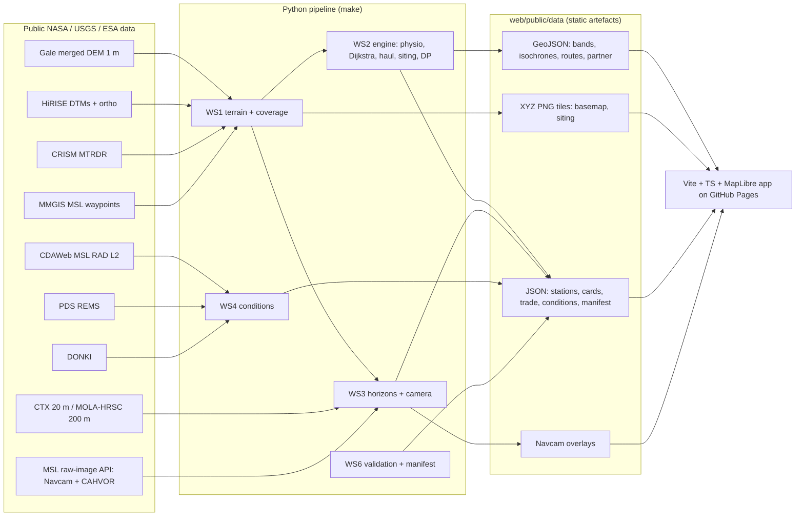

# 🧭 HOMELINE — project proposal & technical specification

> ✅ **Decision: HOMELINE is the project we build** for NASA Space Apps 2026, challenge _Interplanetary Survival Guide: Martian Map_. This page is the full proposal and technical specification. It covers every feature, how each one is built, the data contracts between the pipeline and the web app, and the decisions still open. It is meant to be cut into tickets and agent briefs.
>
> **Event:** 2026-11-14 09:00 → 2026-11-15 23:59. **H0** = Sat 09:00 · **submit** Sun 21:00 (H36) · **hard deadline** Sun 23:59 (H39).
>
> **Background:** [Judging Panel Report — Martian Map ideas (simulated panel, 13 Nov 2026)](https://app.notion.com/p/417961bcb6118114be69f701476063bb). HOMELINE scored 79.2 against F 74.9 and C 74.1, with 8/8 first-place votes, in a simulated panel. The three red-team fixes the panel required are built into this spec (§3).

> ⚠️ **Pre-event rule.** Space Apps forbids starting work before the hackathon. This page is a text spec, which counts as allowed prep. There is no code, no data download and no figure before H0. Every X/Y/Z and every value marked _(compute)_ or _(verify at H0)_ is produced or checked during the event. Numbers taken from published sources are cited as such.

> **One sentence for the judges:** "Mars isn't flat: HOMELINE draws where a suited crew can really go and still get home, and checks it against Curiosity's own photos."

# 1. Proposal

## 1.1 Problem

- **Walkback limits are flat-ground circles.** NASA is _considering_ a 30-min or 60-min walkback for Mars EVAs: 1.8 or 3.5 km at 2.2 mph on flat ground. The ICES-2026-127 slides add that "the 30-minute walkback may be preferred". Mount Sharp's flank rises hundreds of metres across the study area, and 1–2 m boxwork ridges force detours, so a circle overstates where a crew can go.
- **Suited walking on Mars is costly.** Mars gravity is 2.3× the Moon's. NASA's Mars-offload suit tests put brisk suited walking near the sustainable aerobic limit, and suit mass is still being traded.
- **Marswalks are done in pairs.** Getting home also means getting an incapacitated partner home.
- **No help in time.** One-way light time is about 11 min, so turn-back calls are local and made in minutes.
- **Existing tools work at the wrong scale.** Mars Trek and USGS maps are regional, and route planners draw a single line. None shows the moving edge of "both of us can still get home".

## 1.2 Users

- **Primary:** the two-person EVA crew (tablet or cuff card) and the intravehicular crewmember in the pressurized rover who runs the EVA (planning console).
- **Users today:** NASA EVA, suit and architecture teams sizing walkback and suit mass; analog planners (JETT, CHAPEA "Marswalks"); Artemis EVA planners. The engine runs on any HiRISE or lunar DTM.

## 1.3 The product in one paragraph

HOMELINE is a static web app for a 3 × 3 km focus area on lower Mount Sharp, Gale crater, around Curiosity's boxwork and the Gediz Vallis sulfur field. From a rover pad it draws the terrain-true **homeline**: where a suited crew can be and still walk home in 30 or 60 min. The homeline is drawn as an uncertainty band, and every edge is labelled with what sets it. Each science station gets a card showing **Curiosity's real Navcam photo with the predicted skyline**, with its error measured over many rover stops. A dashed **partner line** asks where one astronaut could still haul the other home. A **trade table** shows how suit mass and walkback length change the science you can reach. A **radiation panel** replays the 20 May 2024 storm from Curiosity's RAD and shows a local alarm plus a dose-budget leash. Everything is precomputed from public NASA data during the event, so the app needs no server and still works in January 2027. A **live HUD** replays a simulated EVA along the route on real terrain: an astronaut marker walks the map, and a helmet-style panel shows time home, oxygen, turn-back countdown and radiation margin. It accounts for **position uncertainty**, and an optional **3D first-person view** shows the same HUD at eye level. A **navigation layer** adapts the rover-proven approach to the crew: continuous dead reckoning that drifts, corrected by periodic fixes. One fix type is demonstrated on Curiosity's real Navcam photos by matching the skyline against the orbital elevation model. A fix-interval map then states how often a crew must get a fix to stay safe.

## 1.4 Site and science stations

- **Focus area:** ≈137.37–137.42°E, 4.77–4.82°S. **Planning extent:** 3.7 km radius around the pad, enough for the flat 60-min disc.
- **Why Gale and not Jezero:** it is the brief's own example site; it has RAD radiation data through Nov 2026; MSL Navcam uses the simpler CAHVOR camera model; the relief makes the envelope matter; and the site is less crowded (14 public repos mention Gale against 26 for Jezero).
- **Default pad:** the centroid of Curiosity's 2025–26 boxwork drive ends, ≈4.806°S, 137.382°E _(verify at H0 from MMGIS)_. The final pad is chosen by the siting rule in F8.

| # | Station | Science objective | Selection input |
| --- | --- | --- | --- |
| S1 | Boxwork ridge–hollow transect | Ridge cement vs hollow floor: test groundwater cementation | Ridge index + CRISM clay index |
| S2 | Fracture-network survey | Why these patterns, and why only here | Ridge-index density |
| S3 | Nodule census | Where and why nodules form | Visual pick on HiRISE (fixed before H2) |
| S4 | Gediz Vallis sulfur field | Map the stones; find the source layer. ≈2 km out, so this is the 30-vs-60-min trade made visible | Curiosity sol ≈4200 location |
| S5 | Debris-flow boulders | Sample the mountain without climbing it | HiRISE pick |

**Crew defaults** (adjustable): two crew; 6.5 h EVA + 30 min reserve; VO₂max 36 mL/kg/min capped at 50%; body mass 75 kg _(our assumption)_; 104 kg suit + 10 kg tools; the pair walks at the slower pace. **Conditions:** event weekend (Ls ≈ 22°, MY39) and the 20 May 2024 storm replay.

## 1.5 Why it can win

| Criterion (weight) | HOMELINE's case |
| --- | --- |
| Relevance (25%) | The brief's example site; covers science, safety (terrain, suit mobility, partner rescue, radiation) and route; also answers the optional prompts on point-of-view imagery, pairs and rovers, and current conditions |
| Validity (20%) | Mars-offload physiology shown as bands; validation at two scales (footing: tilt; view: skyline); RAD numbers recomputed; unknown terrain stays unknown; every number traces to a file made after H0 |
| Creativity (20%) | Self-explaining envelope edges, a partner-haul line at Mars gravity, and a predicted skyline on the rover's real photo, which no surveyed repo combines |
| Presentation (20%) | Two hero frames: the circle collapsing into the homeline, and the skyline landing on Curiosity's photo |
| Impact (15%) | Site-specific numbers on two trades NASA is weighing now: 30 vs 60 min walkback, and suit mass |

# 2. Features

Each feature has an ID used in tickets. Tiers: **MVP** (gate G1, Sat 19:00), **Core** (G2, Sun 08:00), **Stretch** (only if G2 is green).

## 2.1 Feature list

| ID | Feature | Tier | Workstream | Output artefact |
| --- | --- | --- | --- | --- |
| F1 | Terrain stack, source mask and cell states | MVP | WS1 | `terrain/dem_1m.tif`, `source_mask.tif`, `cellstate_3m.tif` |
| F2 | Slope, roughness and no-go grid | MVP | WS1 | `slope_1m.tif`, `maxslope_3m.tif`, `ridge_index.tif` |
| F3 | Suited mobility model and speed governor | MVP | WS2 | `engine/physio.py`  • KAT report |
| F4 | Homeline: return field, 30/60-min bands, edge causes | MVP | WS2 | `scenarios/*/homeline.geojson`, `edges.geojson` |
| F5 | Budget slider (0–60 min) | MVP | WS2 + WS5 | `scenarios/*/isochrones.geojson` (1-min steps) |
| F6 | Scenario picker: variant × budget × suit mass | Core (104 kg in MVP) | WS2 + WS5 | `scenarios/index.json` |
| F7 | Station science scoring | Core | WS1 | `stations.json` |
| F8 | Siting heatmap and pad rule | Core | WS2 | `siting.tif` → PNG overlay, `pad.json` |
| F9 | Traverse optimiser: order, legs, timeline, O₂ checkpoints, turn-back times | MVP (3 stations) → Core | WS2 | `route_*.geojson`, `timeline_*.json` |
| F10 | Partner line: haul field (dashed, off by default) | Core | WS2 | `scenarios/*/partner.geojson` |
| F11 | Trade table: science reachable × walkback × suit mass | Core | WS2 + WS5 | `trade_table.json` |
| F12 | Point horizons and skyline projection on Navcam | Core (1 frame in MVP) | WS3 | `horizons/*.json`, `cards/*/overlay.png` |
| F13 | Validation: V1 tilt, V2 skyline by distance class | MVP (V1) → Core (V2) | WS3 + WS6 | `validation/v1.json`, `v2.json`, figures |
| F14 | Conditions: RAD rate, storm replay, tripwire, dose leash; REMS climatology; Mars clock and sun; DONKI context | MVP (RAD) → Core | WS4 | `conditions/*.json` |
| F15 | Station cards and printable cuff card | Core | WS5 | `cards/*.json`, `/cuff.html` |
| F16 | Scorecard and provenance manifest | MVP | WS6 | `manifest.json`, `/scorecard` view |
| F17 | Static web app shell and deploy | MVP | WS5 | GitHub Pages site |
| F18 | Live HUD on the 2D map: playback clock, walking marker, HUD panel, drag-anywhere mode | Core | WS7 | `/hud` view, `fields/*.png` |
| F19 | Position input and uncertainty: position sources, worst-case-within-σ fields, uncertainty circle, simulated drift and fixes | Core (drift: Core if time) | WS7 | `fields/*_worst_*.png`, `config/hud.yaml` |
| F20 | 3D first-person replay on rails with the same HUD | Core (R owns) | WS8 | `/hud3d` view, `fp3d/*` |
| X1 | Rover-rescue drive-time field | Stretch | WS2 | — |
| X2 | Sky-view shelter layer for parking | Stretch | WS3 | — |
| X3 | Radio line of sight to the rover | Stretch | WS3 | — |
| X4 | Helmet-display replay | Stretch | WS5 | — |
| X5 | THEMIS soft-ground penalty | Stretch | WS1 | — |
| F21 | Dead-reckoning simulation: Monte Carlo error ellipses, fix events, fix-interval map | Optional add-on (suspended 2026-11-14 14:19, user) | WS9 | `nav/*.json`, `fields/fix_interval_*.png` |
| F22 | Skyline-matching navigation fix on real Navcam (promoted from X6) | Optional add-on (suspended 2026-11-14 14:19, user) | WS9 | `localisation/*.json`, `nav/fixes.json` |
| X8 | Visual-odometry drift calibration on Curiosity drives | Optional add-on (suspended 2026-11-14 14:19, user) | WS10 | `vo/*.json` |
| X9 | MGL-style ground-image matching (stereo panorama → top-down view → HiRISE match) | Optional add-on (suspended 2026-11-14 14:19, user) | WS10 | `vo/orthomatch_*.json` |
| X7 | 3D free walk (keyboard or touch, slope-limited speed, O₂ drain) | Stretch, realistically not built | WS8 | — |

**Cut order**, first to last: X9 → X7 → X8 → X4 → X3 → X2 → X1 → F20 (3D falls back to a link to the 2D HUD) → F22 (fixes at rover and stations only) → F21 (fall back to F19's flat drift rule; keep the uncertainty circle) → cuff-card PDF (keep HTML) → suit masses 80/120 (keep 104) → V2 from 30 stops to 10. If F18 itself slips, ship the **HUD-on-card fallback** (§2.3).

> ⏸️ **2026-11-14 14:19 (user):** X9, X8, F22 and F21 are now **out of core** (optional add-ons, see §2.4). The core uses their cut-order fallbacks: F19's flat drift rule with the uncertainty circle, and fixes at the rover pad and surveyed stations only.

**Never cut:** F1 cell states, bands, co-registration, V1, one skyline overlay, F10 at nominal mass, the RAD tripwire, F16.

**Not building:** Jezero, a DONKI-based trigger, Cesium 3D (the optional 3D view uses Three.js, F20), Unity, any runtime server (FastAPI etc.), real navigation hardware or sensor fusion, a terrain dose map as headline, Mastcam overlays.

## 2.2 Feature specifications

### F1 — Terrain stack, source mask, cell states

- **Primary terrain:** USGS MSL Gale Merged DEM 1 m v3 (HiRISE + CTX + HRSC on MOLA). It is read as a window over the planning extent from the ASC S3 VRT through GDAL `/vsicurl/`; about 0.5 GB for the window _(verify at H0)_.
- **Source mask:** per-cell origin (HiRISE = 1, CTX = 2, HRSC/MOLA = 3). Derive it from the mosaic's source footprints if published; otherwise from the footprints of the HiRISE DTMs in the USGS STAC collection `mro_hirise_socet_dtms`. _Decision D3._
- **Cell states** on the 3 m routing grid: `0 assessed` (all 1 m cells HiRISE-derived), `1 blocked` (max slope above the limit), `2 unknown` (any non-HiRISE or nodata cell). Unknown cells are never entered by a route and are left out of every percentage.
- **Cross-check only:** HiRISE DTMs `DTEEC_009149_1750_009294_1750_U01` and `DTEEC_019698_1750_019988_1750_U01`. Report the elevation difference against the merged DEM (median, P90). These are never used for routing.
- **Co-registration** to rover positions: grid-search the horizontal shift (±200 m, 2 m steps) that minimises the MAD of (DEM − rover elevation) over drive ends; publish the shift and residuals. On the merged DEM the shift should be ≈0, which is a frame check.
- **Acceptance:** source-mask fractions match the overview within 1%; the coverage map is published; the pad's 30-min flat disc is ≥90% assessed (otherwise the pad moves by rule).

### F2 — Slope, roughness, no-go

- **Slope:** a plane fit over a 3 × 3 window of 1 m cells (Horn); compare with a 5 m window and report the difference.
- **Routing grid:** 3 m cells, each holding the _maximum_ 1 m slope inside it plus the mean elevation.
- **No-go:** 20° nominal, 25° optimistic. 17–20° is flagged "beyond tested suited data" (IST-2 tested up to ≈17°). The conservative variant subtracts the V1 slope RMSE from the limit.
- **Roughness:** RMS residual of a plane over 5 m. **Ridge index:** elevation minus a 15 m median-filtered surface; cells above the threshold (≈0.75 m, tuned to JPL's 1–2 m ridge relief) are "ridge". It feeds S1/S2 scoring and the partner-line mask.

### F3 — Suited mobility model

Oxygen uptake per kg of body mass at speed v (m/s), grade θ and carried mass M (suit plus tools):

$$
\dot V_{O_2} = V_0 + a(M)\,v + k(\theta, M)\,v,\qquad k = \frac{(m_b+M)\,g\,\sin\theta}{\eta\,m_b}\cdot\frac{60}{20.1}\quad(\theta>0)
$$

- **Anchor:** a(120 kg) is set so that level walking at 0.98 m/s, g = 3.71 m/s² gives ≈19 mL/kg/min (ICES-2026-127). V₀ ≈ 6 (assumed).
- **Mass sensitivity:** the slope of a(M) comes from IST-2's weight-condition increments. IST-2 never sets the absolute level.
- **Uphill:** η = 0.20–0.25, checked against IST-2's +8.7 / +17.0 mL/kg/min at 20% / 30% grade. **Downhill:** a cost multiplier with its minimum near −10% grade, rising with braking (Minetti 2002 shape, scaled to the Mars anchor).
- **Governor:** v* = min(v_safe(θ), (0.5·VO₂max − V₀)/(a + k)). v_safe = 1.0 / 0.6 / 0.3 m/s for 0–10° / 10–17° / 17–20° (assumed).
- **Consumables:** O₂ (L) = ∫ V̇O₂ · m_b dt / 1000. Heat ≈ 20.1 J per mL O₂, compared with NASA's 1,200 BTU/h average and 3,000 BTU/h peak.
- **Variants:**

| Variant | η | V₀ | Slope limit | Extra |
| --- | --- | --- | --- | --- |
| Optimistic | 0.25 | 5 | 25° | — |
| Nominal | 0.225 | 6 | 20° | — |
| Conservative | 0.20 | 7 | 20° − RMSE | a +10% |

- **Acceptance (KAT):** 19 ± 1 mL/kg/min at the anchor; monotonic in grade and mass; v* ≤ v_safe everywhere.

### F4 — Homeline

- **Graph:** the 3 m grid with 16-neighbour directed edges (8 neighbours + 8 knight moves). Edge time t(x→y) = length / v*(θ_xy), where θ_xy comes from the elevation difference over the horizontal length. Edges into blocked or unknown cells are removed.
- **Return field:** one reverse Dijkstra from the pad (relaxing predecessor x of y with cost t(x→y)) gives T_home(x), O₂_home(x) and a way-home pointer raster. Run once per variant × suit mass.
- **Bands:** the nominal contour at 30 and 60 min, with conservative (inner) and optimistic (outer) shading.
- **Headline:** "reachable X% (Y–Z%) of the _assessed_ flat disc" _(compute)_.
- **Edge causes:** for every boundary cell of the nominal envelope, inspect its outward neighbours. Unknown, or within 20 m of a source boundary → `data`; blocked → `slope`; otherwise → `physiology`. Merge consecutive boundary cells into labelled LineStrings.
- **Route margin:** m(t) = min(O₂_left − (1 + r)·O₂_home, t_dark − t − T_home, τ_dose − T_home), with reserve r = 0.2 (assumed). The cuff card names the binding term.
- **Acceptance:** flat plane gives T = d/v ± 1% and a circular envelope; on a 10% plane it reaches farther downhill; a > 20° wall is never crossed.

### F5 — Budget slider

- **Approach:** precomputed isochrones. For each scenario, contour T_home at every 1 min from 1 to 60 min, simplify to 2 m tolerance, and store as one GeoJSON FeatureCollection with a `minutes` property. The slider filters by `minutes` with a MapLibre filter expression: instant, no server.
- **Size budget:** under 1.5 MB per scenario gzipped _(check)_; otherwise use 2-min steps.

### F6 — Scenario picker

- **Grid:** 3 variants × 3 suit masses (80 / 104 / 120 kg; 80 kg is _our_ sensitivity value) = 9 return fields. Walkback length is just a contour level (30/60), so it needs no extra runs.
- **Haul:** 2 casualty masses × nominal variant × cart case = 2 haul fields. _(2026-11-14, D20: was 2 cases (cart, drag) = 4; the drag case is not drawn, only reported as a finding, see F10.)_
- **`scenarios/index.json`** lists the scenario IDs, parameters and file paths. Frozen at Sat 23:00.

### F7 — Station science scoring

- **Fixed rule** (no reviewer judgement): value = 0.4·CRISM index (normalised; SINDEX2 for sulfates, D2300 for clays) + 0.4·ridge-index density within 25 m + 0.2·manual priority (S3–S5 hand picks).
- **CRISM:** MTRDR `FRT000058A3` and `FRT0000B6F1` from PDS ODE, resampled to 18 m.
- **Output:** `stations.json` with id, name, lon/lat, value, objective text, task list and dwell time (default 30 min).

### F8 — Siting heatmap and pad rule

- **Candidates:** every 20 × 20 m block that is assessed and has a max slope ≤ 5°.
- **Cost:** one _forward_ Dijkstra from each station (≤ 8 runs) gives the time from each station to every candidate. Score = Σ station value for stations whose conservative return time is ≤ 30 min, then a tiebreak on lower elevation than the value-weighted station centroid (tired returns run downhill).
- **Output:** a heatmap PNG overlay, `pad.json` (chosen pad plus the top 3), and two-pad (rover-hop) options as text.

### F9 — Traverse optimiser

- **Legs:** pairwise station-to-station times from forward Dijkstra runs, already available from F8. Legs are stored as GeoJSON paths.
- **Orienteering:** exact DP over station subsets, O(2ⁿ·n²) with n ≤ 12, which is trivial. Maximise Σ value subject to Σ(walk + dwell) ≤ 6.5 h and margin m(t) ≥ 0 along every leg (the check uses T_home at sampled path points).
- **Outputs:** order, legs, a timeline with arrival, dwell and turn-back times, and O₂ checkpoints every 30 min. Stations outside the partner line are flagged.
- **Acceptance:** the DP result equals brute force on 8 stations.

### F10 — Partner line (design question)

> 🛒 **2026-11-14 14:22 (user, D20):** the partner line is the **cart haul only** (60 min). Dragging is reported as a finding, not drawn: with the config values it exceeds boot traction on every cell, even on flat ground.

- **Haul force:** F = m_IC·g·(μ cos θ + sin θ). Cart case μ = 0.1–0.4; drag case μ ≈ 0.5–0.7 _(assumed)_. _(2026-11-14, D20: the drag case is computed only for the infeasibility finding, never drawn.)_
- **Haul speed:** v_haul = min(v_safe/2 downhill, ε·P_avail / F), with ε = 0.20–0.25 and P_avail = rescuer power at 60–80% of VO₂max minus their own walking cost (via F3). Infeasible if v_haul < 0.1 m/s or F exceeds traction (μ_boot ≈ 0.5, assumed). Ridge cells (F2) are masked.
- **Casualty masses:** 155 / 179 / 195 kg (suited crewmate = body + suit, follows the suit slider; `haul.yaml` rule, C decision 2026-11-14 15:35, was 165–186 kg) and NASA's 343 kg rescue specification as the bound.
- **Output:** the 60-min haul contour (Scoville's Artemis III 1 h benchmark), drawn dashed and off by default, captioned "Design question. Every haul parameter is an assumed band." _(2026-11-14, D20: layer label "Partner line (cart haul, 60 min)"; the partner layer and the station cards carry the note "One astronaut cannot drag a suited crewmate on Mars without a cart or sled: the pull needed exceeds boot grip even on flat ground." Its numbers (drag force, traction limit, max draggable mass) come from the manifest.)_

### F11 — Trade table

- **Rows:** walkback 30/60 min. **Columns:** suit mass 80/104/120 kg.
- **Cells:** science value reachable (Σ station value within the conservative homeline), % of the assessed disc reachable, and partner-line area. Rendered as a table with a small bar per cell.

### F12 — Point horizons and skyline projection

- **Observers:** stations, pads and validation stops (a few hundred). Eye height 1.7 m for crew, mast height ≈1.9 m for Navcam _(verify at H0)_.
- **Rays:** every 0.25° (1,440 rays). Samples run every 1 m to 2 km on the 1 m DEM, every 20 m to 30 km on CTX, then every 200 m on MOLA–HRSC to the crater rim (~80 km). Elevation angle = atan((z − z₀ − d²/2R)/d) with R = 3,396.19 km; the horizon is the running maximum. The output also records the distance to the horizon point, which defines the distance class.
- **Panorama render** for cards: an equirectangular strip of the horizon profile plus labelled landmarks (bearing, distance).
- **Navcam projection:**
  1. Pull frames from the MSL raw-image API filtered by sol and site/drive. Keep frames whose drive end lies in the focus area and that show the skyline.
  2. Read the CAHVOR vectors and the rover attitude quaternion from the image metadata _(field names: verify at H0)_.
  3. Transform horizon points from site frame → rover frame using the attitude, then project with the CAHVOR model: x = (P−C)·H / (P−C)·A, y = (P−C)·V / (P−C)·A, with the R (radial) correction.
  4. Draw the predicted skyline and landmark ticks on the frame as a transparent PNG overlay.
- **Acceptance (KATs):** curvature drop at 20 km = 58.9 m; a 100 m wall at 1 km seen from 1.7 m = 5.61°; projection round trip < 0.5 px; A-vector and yaw within 1° of the label.

### F13 — Validation

- **V1, footing:** DEM slope over the rover's ≈3 m footprint vs IMU tilt (from MMGIS) at every drive end in the focus area. Report bias, RMSE, r, and a confusion matrix at 10° and 20°. Caveat: the rover chose gentle ground.
- **V2, view:** automatic sky-boundary detection per image column (top-down search for the first strong vertical gradient below the smooth sky region), then a manual check of 20% of frames. Report the predicted vs observed skyline elevation angle per column, then the median and P90 by distance class (<0.5 km, 0.5–2 km, >2 km) over ≥10 stops (30 if time allows). Show the near-field misses. **Quote only the far-field figure in the video.**
- **Page wording:** "The skyline check validates the DEM–camera–pose chain. It is not a hazard validation."

### F14 — Conditions

- **RAD:** CDAWeb dataset `MSL_RAD_OBS-L2` via HAPI or the `cdasws` Python client _(variable names: verify at H0)_. Outputs: current dose rate with the data lag stated, baseline, and the 20 May 2024 storm series.
- **Storm numbers** (recomputed): peak ≈ 8.1–8.4 mGy/day; event excess 1.7–1.9 mGy; ≈2 mSv at ⟨Q⟩ ≈ 1. Q ≈ 3 is never applied to the SEP. The WRMISS "(peak)" derivation is shown on the page.
- **Tripwire (the alarm):** more than 3× baseline in two consecutive samples.
- **Leash:** τ_dose = D_allow / Ḋ_current. D_allow defaults to 0.5 mGy (adjustable, labelled as an assumption). Example: at a 0.35 mGy/h peak, τ ≈ 85 min. The crew turns back when T_home ≥ τ_dose.
- **REMS:** same-season (Ls 10–35°) climatology from PDS `mslrem_1001`. The latest feed sol is shown and marked "stale since 25 Aug 2026".
- **Clock:** Mars24 algorithm (Allison & McEwen 2000) gives LMST at Gale, Ls, sunrise and sunset; local daylight at each station comes from the F12 horizon. Light time comes from JPL Horizons, cached.
- **DONKI:** cached CME, ENLIL and notification records, labelled "context only, not a trigger".

### F15 — Station cards and cuff card

- **Card:** station name and objective; Navcam frame with skyline overlay and its error; predicted panorama; arrival, dwell and turn-back time; T_home and O₂_home from the station; the binding margin term; a contingency line ("partner down: haul via this path, N min" from F10); tasks.
- **Cuff card:** a print-styled HTML page (A6 per station) with the timeline, O₂ checkpoints and turn-back times.

### F16 — Scorecard and provenance

- **Scorecard view:** the coverage map and fractions, co-registration residuals, V1, V2, RAD checks, KAT pass list, the assumptions table, and the real / modelled / simulated table.
- **Manifest:** every on-screen number has a key in `manifest.json` → value, units, source file, generating script, git commit and UTC timestamp. CI fails if any timestamp is before H0.

### F17 — Web app shell

- **Pages:** `/` (planning console), `/station/:id`, `/trade`, `/conditions`, `/scorecard`, `/cuff`, `/about` (data, licences, SI-use statement).
- **Default map view:** the HiRISE basemap, the 30-min nominal band, edge causes and the stations. Everything else sits behind toggles.

## 2.3 HUD block (F18–F20, X6)

> 🪖 **What "real-time" means.** A playback clock runs a **simulated EVA on real terrain**. Each frame, the HUD looks up the current position and EVA time in precomputed fields and the route timeline. Nothing is computed live, and there is no live telemetry (RAD, for example, lags about 2 days). Every HUD view carries the label "Simulated EVA · real terrain and data".
>
> **Why it's cheap:** every HUD number is a texture lookup into rasters the engine already produces. The cost is in rendering and UI, not science.

### F18 — Live HUD on the 2D map

- **Route:** `/hud`, also embedded as a toggle in the planning console.
- **Playback clock:** speeds 1× (real time), 30×, 60× (default) and 300×; play, pause and a scrubber over the 6.5 h EVA. The marker follows `route_*.geojson` using `timeline_*.json`; dwell at stations is shown as a progress ring.
- **Drag-anywhere mode:** drag the marker anywhere (or click). The HUD instantly shows "From here: home in N min (conservative M), O₂ needed X L", and the way-home path is drawn from the pointer raster.
- **Band colouring by margin:** while playing, the homeline band shades green (margin > 10 min), amber (0–10 min) and red (< 0).
- **Storm switch:** "replay 20 May 2024 storm during this EVA" shifts the storm series onto the EVA clock, so the tripwire fires and the dose leash starts counting down.

**HUD panel**, a DOM overlay styled like a helmet display, in two levels to avoid clutter:

| Element | Source | Default level |
| --- | --- | --- |
| Time home, nominal (conservative) and margin to the walkback budget | `t_home` field (+ conservative field) | Minimal |
| O₂ left vs O₂ needed to get home; binding limit (O₂ / daylight / dose) | `o2_home` field + timeline | Minimal |
| Turn-back countdown | Timeline | Minimal |
| Bearing and distance to the rover; compass ribbon | `home_bearing` field + pad | Minimal |
| Alarm banner (turn back / radiation / position uncertain) | Rules below | Minimal |
| Next-station ETA and task | Timeline + `stations.json` | Expanded |
| Slope underfoot and governor speed | `slope` field + F3 | Expanded |
| Partner status: inside or outside the partner line | `partner` polygon | Expanded |
| Dose rate, tripwire state, time left on the dose budget | `conditions/rad.json` | Expanded |
| Sun elevation and time to dark at this spot | Mars24 + horizon | Expanded |
| Minimap with band, route and uncertainty circle | Map layers | Expanded |

**Alarm rules** (first match wins):

1. `margin_min < 0` → red "TURN BACK NOW"
2. Tripwire fired and `t_home ≥ τ_dose` → red "RADIATION: HEAD HOME"
3. Uncertainty circle crosses the homeline → amber "POSITION UNCERTAIN: HEAD TOWARD ROVER"
4. `margin_min < 10` → amber "TURN-BACK IN N MIN"
5. Outside the partner line → grey info "Beyond partner-haul range"

**Acceptance:** at the pad the HUD shows T_home = 0; along the route the HUD's T_home matches the timeline within ±0.5 min; alarms fire at the times the timeline predicts; 60 fps on a mid-range laptop.

### F19 — Position input and uncertainty

**One position interface.** Everything in the HUD reads a single object:

```json
{"lon": 137.382, "lat": -4.806, "sigma_m": 25, "source": "playback" , "t_eva_min": 142, "last_fix": {"source": "station", "t_eva_min": 120}}
```

| Source | When | σ |
| --- | --- | --- |
| `playback` | Default; marker on the planned route | 0, or grows with drift if enabled |
| `drag` | User drags or clicks | User-set (slider 0–100 m, default 0) |
| `drift` | Playback with simulated dead reckoning | Grows with distance walked |
| `fix` | At the rover, at a station, or from an F22 skyline fix | Resets σ to the fix accuracy |

**Uncertainty-aware margins.** With position known only to ±σ, the HUD shows the **worst case within σ**, not the value at the dot:

- The pipeline precomputes `t_home_worst_{10,50,100}` and `o2_home_worst_{10,50,100}`: a circular max filter of the field with radius 10, 50 or 100 m, nominal 104 kg scenario only.
- The client picks the smallest precomputed radius ≥ σ.
- The map draws an uncertainty circle of radius σ around the marker. If it crosses the homeline, alarm 3 fires.

**Simulated drift** (assumed, labelled; this flat rule is the **fallback**. When F21 lands by G2, its Monte Carlo ellipses replace it, see §2.4):

> ⏸️ **Core plan since 2026-11-14 14:19:** this flat rule and the circle are the default; F21 and F22 are optional add-ons (§2.4). Core fixes are the rover pad and surveyed stations only.


- σ grows at **2% of distance walked** since the last fix (`config/hud.yaml`), with a floor of 5 m.
- Fixes reset σ: at the rover pad → 2 m; at a surveyed station → 5 m; an F22 skyline fix → its measured error.
- A HUD line shows "Position: dead reckoning · ±N m · last fix M min ago".
- The page states plainly: Mars has no GPS. Rovers use visual odometry plus matching to orbital maps (Perseverance's Mars Global Localization since Feb 2026); a GPS-like broadcast exists only as a plan for the Moon (LunaNet). HOMELINE takes position as an input with uncertainty; it is not a navigation system.

**Acceptance:** the worst-case field is ≥ the point field everywhere; σ is monotonic between fixes and resets at a fix; alarm 3 fires exactly when the circle crosses the band in a synthetic test.

### F20 — 3D first-person replay on rails (core, owned by R)

- **Route:** `/hud3d`; the same playback clock, position object and HUD components as F18, with a camera at 1.7 m eye height following the route.
- **Stack:** Three.js (not Unity: same files, loads in seconds, no second toolchain).
- **Terrain:**
  - **Near:** 1 m height chunks (256 × 256) along a corridor about 300 m wide around the route, as Float32 binaries, gzipped.
  - **Far:** one 8 m mesh over the planning extent, plus the computed horizon as a far-skyline ring so the crater rim is correct.
  - **Texture:** the HiRISE orthoimage as JPEG chunks matching the near chunks; greyscale where the colour strip doesn't cover.
- **Look:** sun direction from Mars24 at the simulated LMST, a Mars sky gradient and distance haze (which also hides the coarse far field).
- **Honesty:** a fixed caption "1 m terrain: ridges under ~3 m are not resolved". The station card keeps the real Navcam photo as the validation frame.
- **Durability:** a loading screen with size and progress; if WebGL2 is missing or the frame rate stays under 20 fps, it falls back to the 2D HUD.
- **Budget:** ≤ 30 MB total download; ≥ 30 fps on a mid-range laptop.
- **Acceptance:** camera height 1.7 ± 0.1 m above the terrain; the rendered skyline at each station within 0.5° of the computed horizon.

### F22 — Skyline-matching navigation fix (optional add-on since 2026-11-14, D19; formerly X6, full spec in §2.4)

> ⏸️ **2026-11-14 14:19:** optional add-on, not core (§2.4). The core HUD takes fixes at the rover pad and surveyed stations only.

1. Take a Navcam frame from a known drive end, hiding the true position.
2. Compute predicted horizons on a 50 m candidate grid over 1 km² around a prior position, then refine at 10 m around the best three.
3. Score each candidate by the RMS difference between the predicted and detected skyline elevation angles (far-field columns weighted higher).
4. Report the recovered position and its error against Curiosity's true drive end, and feed it to F19 as a `fix` with σ = that error.

It reuses F12/F13 code and runs only after V2 works. Expect tens to hundreds of metres, and present it as a backup idea, not navigation.

### HUD-on-card fallback

If F18 slips past G2: every station card gets a static HUD strip over the Navcam photo (time home, O₂ needed, turn-back time, bearing to the rover). About 3–5 h, owned by WS5.

### HUD effort

| Item | Hours | Owner |
| --- | --- | --- |
| Field export to RG-encoded PNG + browser decoder (F18/F19) | 2 | WS7 agent (reviewer C) |
| HUD panel components, two levels, alarms | 3 | WS7 agent (reviewer D) |
| Playback clock, scrubber, route-following marker | 1.5 | WS7 |
| Drag-anywhere mode + way-home path | 1 | WS7 |
| Band colouring, storm switch | 1 | WS7 |
| Position interface + worst-case fields + uncertainty circle | 3 | WS7 + WS2 (max filter) |
| Simulated drift and fixes | 1.5 | WS7 |
| Polish, tests, capture | 1.5 | WS7 |
| **WS7 total** | **≈ 14.5** |  |
| Terrain chunks, far mesh, textures (export) | 3–4 | WS8 agent (reviewer S for terrain) |
| Three.js scene, chunk loading, camera path | 4–5 | WS8 |
| Sky, sun, haze | 1.5 | WS8 |
| HUD integration (shared components) | 1.5 | WS8 |
| Performance, loading, fallback | 2 | WS8 |
| Capture | 1 | WS8 |
| **WS8 total** | **≈ 13–15** |  |
| F22 skyline-matching fix (see §2.4; optional add-on since 2026-11-14, D19) | 3–4 | WS9 |

## 2.4 Navigation block (F21, F22, X8, X9)

> ⏸️ **Suspended softly, 2026-11-14 14:19 CET (user).** Odometry and position determination (F21, F22, X8, X9) are no longer core; they are **optional add-ons**, done only if time allows. No new jobs start on them. Merged work stays in place and keeps working (WS9 nav outputs, `/nav`, the HUD ellipse, the WS10 VO results, `nav.yaml` `vo:`), labelled as an optional add-on. The core does not depend on it.
>
> **Why** (numbers from STATUS.md):
> 1. **F22 does not constrain position at this site.** 35 frames: median error 657 m, none within 100 m; station frames S1/S2/S4 788/280/966 m, none passes the 10 m gate. The far skyline is not seen (haze) in 21 north-facing far-fail frames (D7 manual check pending).
> 2. **F21's fix-interval headline (median 50.7 m) is dominated by the fragmented terrain**, not the drift model. N's review of the model conventions is pending (reserve set to 0; does σ_b per hour of rover driving carry over to a walker?).
> 3. **X8 is a rover analogue only:** it works only at 256²; the reference positions (MMGIS drive ends) are not independent of Curiosity's own VO; the plausibility thresholds were proposed by the agent and are unconfirmed by N.
> 4. **X9** was always a stretch goal (after G2 only).
>
> **Core fallbacks (the default plan):** F19's flat drift rule plus the uncertainty circle instead of F21's ellipses (§2.1 cut order); fixes at the rover pad and surveyed stations only instead of F22.

> 🧭 **The idea.** Rovers already solve "where am I?" without GPS with a two-part loop: continuous odometry that drifts, plus periodic fixes by matching camera views to orbital maps. Perseverance does both on board; Mars Global Localization has been used in operations since Feb 2026 and reaches about 25 cm. HOMELINE adapts the same loop to a walking crew: **suit odometry (concept) + periodic map-matching fixes**. The accuracy of both feeds straight into the homeline, the HUD margins and a new planning number: **how often the crew must take a fix**.
>
> **What we build vs what we claim.** The odometry is **simulated** with assumed parameters (or ones calibrated on Curiosity via X8). One fix type is **demonstrated on real data**: skyline matching on Curiosity's Navcam photos (F22). Suit inertial sensors and helmet cameras are a concept, labelled as such. Rovers are the precedent. MGL-style image matching is named as the production method; our skyline fix is coarser (tens to hundreds of metres), and the page says so.

| Part | Rover today | Crew in HOMELINE (concept) | What we build |
| --- | --- | --- | --- |
| Continuous estimate | Visual + wheel odometry | Suit inertial sensors + step counting | F21: simulated dead reckoning, Monte Carlo ellipses |
| Periodic fix | Panorama matched to orbital imagery (MGL) | Helmet or handheld camera matched to the orbital elevation model | F22: real skyline-matching fixes on Curiosity's Navcam |
| Fixes at known points | — | At the rover, at surveyed stations | F21: fix events reset the error |
| When to fix | Operators or MGL decide | Planned ahead | F21: fix-interval map |
| Calibration | Mission experience | — | X8: drift measured on Curiosity drives (if data allows) |

### F21 — Dead-reckoning simulation and fix-interval map

**Error model** (pedestrian dead reckoning, per step; all parameters assumed and set in `config/nav.yaml`):

- Step length L from cadence and governor speed (≈ 0.7 m at 0.98 m/s, assumed). Estimated step = L·s·(1 + ε), with a per-run scale factor s ~ N(1, σ_s) and per-step noise ε ~ N(0, 5%).
- Heading: ψ_est = ψ_true + ψ₀ + b_g·t + random walk. Initial heading error ψ₀ after a fix, gyro bias b_g ~ N(0, σ_b). Mars has no global magnetic field, so there is no compass correction.
- Slip: on slopes above 10°, extra along-track noise proportional to sin θ (from the slope grid).
- Three parameter sets, plus a fourth from X8 if it lands:

| Set | σ_s | σ_b | ψ₀ | Slip factor |
| --- | --- | --- | --- | --- |
| Low | 1% | 1°/h | 1° | 0.02 |
| Medium (default) | 3% | 5°/h | 3° | 0.05 |
| High | 5% | 20°/h | 5° | 0.10 |
| Curiosity-calibrated (X8) | measured | measured | measured | measured |

**Monte Carlo:** 500 runs along the planned route at 1 s steps, using the timeline's speeds and dwells. For each run, record true and estimated position. Every minute, fit the 2D error covariance and draw the 95% ellipse. Also fit the 95% radial error as a function of distance walked since the last fix: r95(D) = a·D + b·D² (heading bias makes it grow faster than linearly).

**Fix events:** at the rover pad (σ 2 m), at surveyed stations (σ 5 m), and F22 skyline fixes (σ = measured error at that station). A fix resets the error to σ and the heading error to ψ₀. Optional, stretch: range-only radio fix to the rover (σ_r 5 m).

**Fix-interval map:** for every assessed cell x inside the 30-min homeline:

1. Margin radius r_m(x): the largest radius such that the worst T_home within r_m stays below the budget minus reserve (from the worst-case fields of F19, interpolated).
2. Fix interval D_max(x): the largest D with r95(D) ≤ r_m(x).
3. Render D_max in classes (< 100 m, 100–300 m, 300–1,000 m, > 1,000 m), per parameter set.
4. Headline _(compute)_: "On this site at medium drift, a crew inside the 30-min homeline needs a fix at least every N m (median), M m near the edge."

**Acceptance:** zero-error parameters give estimate = truth; heading bias only on a straight route gives the analytic lateral error within 1%; the 95% ellipse covers 93–97% of runs; error resets at fixes; D_max is smaller near the homeline edge and 0 outside it.

### F22 — Skyline-matching navigation fix (on real Navcam)

- **Per station:** take the Navcam frame at or nearest the station's drive end. The prior is the dead-reckoned estimate from F21's sample run, or the true position plus a 300 m random offset for the standalone test.
- **Search:** candidates on a 50 m grid over 1 km² around the prior, then 10 m around the best three. For the coarse pass use 1° rays and only terrain beyond 500 m (far field), which keeps it to minutes per frame.
- **Score:** RMS difference between predicted and detected skyline elevation angle per image column, weighting far-field columns higher; reuses the F12 horizon engine and the F13 sky detector.
- **Output:** the recovered position, its error against Curiosity's true drive end, and σ from the score surface (the region within 1.5× the minimum RMS). This becomes a `fix` event in F21 and the HUD.
- **Report on the page:** errors for all frames tried, failures included.
- **Acceptance:** on a synthetic elevation model with a known observer, the position is recovered within one grid step.

### HUD integration (extends F18/F19)

> ⏸️ **2026-11-14 14:19:** optional add-on. In the core plan the HUD keeps F19's circle and flat drift rule, with fixes at the rover pad and surveyed stations only.

- **Position panel:** "Odometry ±N m · next fix due in M m · last fix: _type_, K min ago". M = D_max at the estimated position minus distance walked since the last fix.
- **Take fix:** in playback, a button (or an automatic prompt when a fix is due) applies the next fix event. At stations with an F22 result, the HUD shows the real Navcam photo with the matched skyline and the measured error; the ellipse shrinks and the margins recover.
- **Uncertainty shape:** the F21 ellipse replaces F19's circle on the map and minimap. Worst-case lookups use the smallest precomputed radius ≥ the ellipse's semi-major axis.
- **Alarm 3** now fires when the 95% ellipse reaches the homeline, with the text "Position uncertain: take a fix or head toward rover".
- **Tracks:** the estimated track is shown by default; the true track sits behind a toggle ("show truth").
- **Parameter set picker** (low / medium / high / Curiosity-calibrated) in the expanded HUD and on `/nav`, a page with the fix-interval map and the method.

### X8 — Visual-odometry drift calibration (conditional)

1. **Data probe, H0–H2, ≤ 30 min of an agent's time:** for 3–5 recent boxwork drives, query the raw-image API for Navcam stereo pairs _during_ the drive, not only at the stops. Check frame spacing, the left/right pairing, the camera models and the rover attitude.
2. **Go** if at least 2 drives have ≥ 10 consecutive stereo pairs at ≤ 2 m spacing with camera models; otherwise **no-go**, recorded in D16.
3. **If go:** a stereo visual-odometry pipeline (OpenCV features, stereo triangulation with the camera model, frame-to-frame motion by PnP with RANSAC, accumulated along the drive). Compare the endpoint with the MMGIS drive-end position. Report drift as a percentage of distance and the heading drift per drive.
4. **Output:** the "Curiosity-calibrated" parameter set for F21, labelled "rover analogue: a rover is not an astronaut".

### X9 — MGL-style ground-image matching (stretch)

At a drive end, turn the Navcam stereo panorama into a top-down image (heights from stereo), then match it against the 25 cm HiRISE orthoimage by normalised cross-correlation over rotation and translation. Report the error against MMGIS. This is the production method's principle on public data. It runs only after G2, only if WS10 is free, and is cut first.

### Navigation effort (with agents)

> ⏸️ **2026-11-14 (D19):** every row below is an optional add-on; no new jobs start on them. Merged work stays.

| Item | Wall clock | Owner |
| --- | --- | --- |
| F21 error model + Monte Carlo + ellipses | 2–2.5 h | WS9 agent (reviewer N) |
| F21 fix-interval map + headline | 1–1.5 h | WS9 (reviewer N) |
| F22 skyline-matching fixes on real frames | 3–4 h | WS9 (reviewer C; reuses WS3 code) |
| HUD integration: panel, Take fix, ellipse, alarm, tracks, `/nav` page | 1.5–2 h | WS9 (reviewer D) |
| **WS9 total** | **≈ 8–10 h** |  |
| X8 data probe | ≤ 0.5 h | WS10 agent (reviewer N) |
| X8 visual odometry, if go | 6–10 h | WS10 |
| X9 ground-image matching | 10–15 h, high risk | WS10, after G2 only |

# 3. Built-in fixes from the judging panel

| # | Fix | Where in this spec |
| --- | --- | --- |
| 1 | Gale merged DEM primary from H0, with a source mask; HiRISE only as cross-check | F1 |
| 2 | Dose-budget leash τ = D_allow / Ḋ replaces tripwire-to-peak; excess-dose test 1.7–1.9 mGy | F4 margin, F14 |
| 3 | Two-beat video; partner line dashed, off by default, with ridges masked | F10, §9 |
| 4 | Partner μ 0.1–0.4, a drag case, a ridge mask _(2026-11-14, D20: drag case is a finding only, not a line)_ | F10 |
| 5 | RAD and REMS sign-off moves to G; fixed CRISM rule; scenario freeze 23:00 | F7, §7 |
| 6 | Skyline error by distance class; far-field figure only in the video | F13 |
| 7 | Co-registration search ±200 m, residuals published | F1 |
| 8 | 80 kg labelled as our value; cite Moon to Mars AS-1LM; "considering", never "rule" | F6, page copy |

# 4. System architecture

Offline Python pipeline → static artefacts → static web app. No runtime server.



## 4.1 Tech stack

| Layer | Choice | Notes |
| --- | --- | --- |
| Language | Python 3.11, managed with `uv` | One `pyproject.toml` |
| Raster I/O | GDAL ≥ 3.8, rasterio, pyproj | `/vsicurl/` windowed COG reads |
| Numerics | numpy, numba, scipy | Numba for Dijkstra, horizons and DP |
| Vector | shapely 2, geopandas | Contours via `rasterio.features` / skimage `find_contours` |
| Images | Pillow, scikit-image | Sky detection, overlays |
| Data APIs | requests, `cdasws` (or HAPI) | Every response cached to `data/raw/` with a timestamp |
| Orchestration | `Makefile` targets per stage | `make terrain engine horizons conditions web` |
| Tests | pytest | KATs as tests; CI on GitHub Actions |
| Front end | Vite, TypeScript, MapLibre GL JS; plain TS with small Preact components for cards and tables | — |
| Hosting | GitHub Pages | Static only; durable to January 2027 |
| HUD | Same Vite/TS app; DOM overlay for the panel; Canvas 2D for decoding field PNGs | F18/F19 |
| 3D (F20 only) | Three.js r16x, WebGL2 | Lazy-loaded on `/hud3d` only |
| Video | Screen capture + DaVinci Resolve or Kdenlive | English subtitles burned in |

## 4.2 Coordinate reference

- **Planetocentric** lon/lat on the Mars 2000 sphere (R = 3,396,190 m).
- **Analysis CRS:** equirectangular centred at 4.8°S, 137.39°E, in metres; a custom PROJ string with `+R=3396190`.
- **Web map:** MapLibre assumes Earth's Web Mercator. We pass Mars lon/lat straight through, which is common practice for planetary web maps. At 4.8°S the shape distortion is negligible, but MapLibre's scale bar is wrong, so we replace it with a custom one using the Mars radius.

## 4.3 Repository layout

```javascript
nasa-space-app/          # existing team repo
├── pyproject.toml, Makefile, LICENSE (Apache-2.0), README.md
├── config/
│   ├── site.yaml          # AOI, pad default, CRS, grid sizes
│   ├── crew.yaml          # VO2max, body mass, suit masses, dwell, reserve
│   ├── variants.yaml      # optimistic / nominal / conservative parameters
│   └── stations.yaml      # S1–S5 seeds, manual priorities
├── pipeline/
│   ├── terrain/      fetch.py  mosaic.py  coverage.py  coreg.py  slope.py  ridge.py
│   ├── engine/       physio.py  graph.py  dijkstra.py  envelope.py  edges.py
│   │                 haul.py  siting.py  orienteering.py  trade.py  scenarios.py
│   ├── horizon/      rays.py  panorama.py  cahvor.py  navcam.py  sky.py  overlay.py
│   ├── conditions/   rad.py  tripwire.py  rems.py  marstime.py  donki.py
│   ├── validation/   v1_tilt.py  v2_skyline.py  figures.py
│   ├── provenance/   manifest.py  check_h0.py
│   ├── export/       fields_png.py  worstcase.py  terrain_chunks.py  far_mesh.py  ortho_chunks.py
│   └── navigation/   deadreckon.py  montecarlo.py  fixinterval.py  skylinefix.py
│                     vo_probe.py  vo.py  orthomatch.py
├── tests/            test_physio.py  test_router.py  test_haul.py  test_horizon.py
│                     test_cahvor.py  test_clock.py  test_rad.py  test_coverage.py
├── data/             raw/ (cached downloads, gitignored)  interim/  (gitignored)
└── web/
    ├── index.html, vite.config.ts, src/ (map.ts, layers.ts, slider.ts, cards.ts,
    │   trade.ts, conditions.ts, scorecard.ts, scale.ts,
    │   hud/ (clock.ts, position.ts, fields.ts, panel.ts, alarms.ts, minimap.ts, drift.ts),
    │   fp3d/ (scene.ts, terrain.ts, path.ts, sky.ts, fallback.ts),
    │   nav/ (ellipse.ts, fixes.ts, tracks.ts, navpage.ts))
    └── public/data/   # pipeline outputs (committed at freeze)
```

# 5. Data

## 5.1 Inventory

| # | Product | Mission | Res. | Access | Est. size | Used by |
| --- | --- | --- | --- | --- | --- | --- |
| 1 | MSL Gale Merged DEM 1 m v3 | MRO, MEX (ESA), MGS | 1 m | USGS ASC S3 VRT, windowed | ≈0.5 GB window | F1, F2, F12 |
| 2 | HiRISE DTMs 009149 / 019698 (USGS-controlled COGs) | MRO HiRISE | 1 m | USGS STAC `mro_hirise_socet_dtms` | ≈0.5 GB | F1 cross-check, source mask |
| 3 | HiRISE ortho `ESP_019698_1750_RED`  • Gale LRGB COG | MRO HiRISE | 0.25 m | USGS ARD / ASC S3 | ≈1 GB → tiles | Basemap |
| 4 | Controlled CTX DTMs | MRO CTX | 20 m | USGS STAC | ≈0.2 GB | F12 mid field |
| 5 | MOLA–HRSC blended DEM v2 | MGS, MEX | 200 m | USGS Astrogeology | window only | F12 far field |
| 6 | CRISM MTRDR `FRT000058A3`, `FRT0000B6F1` | MRO CRISM | 18 m | PDS ODE | ≈0.3 GB | F7 |
| 7 | THEMIS quantitative TI, tile 30S120E | Mars Odyssey | 100 m | USGS Astrogeology | window only | X5, context |
| 8 | MMGIS `MSL_waypoints.json` | MSL | per drive | [mars.nasa.gov/mmgis-maps](http://mars.nasa.gov/mmgis-maps) | < 5 MB | F1 coreg, F8, F13 V1 |
| 9 | Raw-image API: Navcam frames + CAHVOR + attitude | MSL | 1024² | [mars.nasa.gov/api/v1/raw_image_items](http://mars.nasa.gov/api/v1/raw_image_items) | ≈100–300 frames | F12, F13 V2, clock KAT |
| 10 | CDAWeb `MSL_RAD_OBS-L2` | MSL RAD | ~17 min | [cdaweb.gsfc.nasa.gov](http://cdaweb.gsfc.nasa.gov) | < 50 MB | F14 |
| 11 | REMS feed + PDS `mslrem_1001` | MSL REMS | daily | [mars.nasa.gov](http://mars.nasa.gov); PDS Atmospheres | < 0.5 GB subset | F14 |
| 12 | DONKI (CME, ENLIL, notifications) | CCMC | event | [api.nasa.gov](http://api.nasa.gov) (personal key) | < 1 MB | F14 context |
| 13 | JPL Horizons; Mars24 | JPL; GISS | computed | [ssd-api.jpl.nasa.gov](http://ssd-api.jpl.nasa.gov) | — | F14 |
| 14 | ICES-2026-127; IST-2; EVA Walkback Test | NASA JSC | — | NTRS | — | F3, F10 parameters |

**Total download:** about 3–4 GB. Start the large pulls at H0 (WS1) and cache everything; venue Wi-Fi is a risk, so a phone-hotspot fallback is listed in §10.

## 5.2 Real vs modelled vs simulated

| Element | Status |
| --- | --- |
| Terrain, imagery, CRISM, THEMIS; Curiosity positions, tilt, Navcam frames, camera models; RAD dose rates; REMS archive; DONKI records; ephemeris | **Real**, labelled with lag; the REMS feed is marked stale |
| Slope and no-go; metabolic cost, speed, O₂ and heat; return, haul and siting fields; predicted skylines; daylight; storm dose for a hypothetical crew; skyline-matching fix errors (measured on real Navcam); visual-odometry drift on Curiosity drives (X8) | **Modelled** from real data, shown with bands |
| Astronauts, rover pad, casualty, EVA timing, the storm hitting this EVA; the HUD playback, crew position, position drift and fixes | **Simulated or hypothetical**, labelled on screen |

## 5.3 Key assumptions

| Assumption | Value | Basis | Confidence |
| --- | --- | --- | --- |
| Walkback budgets | 30 and 60 min | ICES-2026-127, "being considered" | Medium; not policy |
| Effort cap | 50% of VO₂max 36 | ICES; NASA-STD-3001 | Medium |
| Level cost at Mars offload | ≈19 mL/kg/min at 0.98 m/s, 120 kg | ICES (6 subjects) | Medium |
| Mass sensitivity; η | IST-2 increments; 0.20–0.25 | IST-2 | Low–medium |
| Body mass | 75 kg | Our assumption | — |
| Slope limit; safety speeds | 20° (25° optimistic); 1.0/0.6/0.3 m/s | Scoville; our assumption | Low–medium |
| Haul μ, ε, ceiling, traction | 0.1–0.4 (cart), 0.5–0.7 (drag, infeasibility finding only, D20); 0.20–0.25; 60–80%; 0.5 | Assumed bands | Low |
| Casualty mass | 155 / 179 / 195 kg (body + suit, haul.yaml); 343 kg bound | ICES suit; NASA 2024 rescue challenge | Medium |
| Dose allowance per EVA | 0.5 mGy | Our assumption, adjustable | Low |
| Suit O₂ budget (metabolic) | Primary 504 L (8 h at 1,200 BTU/h), secondary 157 L (1 h at 3,000 BTU/h); margins plan against the primary only | Derived from NASA EVA-EXP-0075, ICES-2026-127, ICES 2026 Mars PLSS study | Medium; no leakage or venting modelled |
| Dead-reckoning error | Low / medium / high sets (§2.4), medium default | Our assumption; Curiosity-calibrated set if X8 lands | Low |
| Fix accuracy at rover / station | 2 m / 5 m | Our assumption | Low–medium |

# 6. Data contracts (pipeline → web)

All files live in `web/public/data/`. Coordinates are lon/lat (Mars 2000 planetocentric) with 6 decimals.

**`scenarios/index.json`**

```json
{
  "default": "nom_104",
  "scenarios": [
    {"id": "nom_104", "variant": "nominal", "suit_kg": 104,
     "files": {"isochrones": "scenarios/nom_104/isochrones.geojson",
               "bands": "scenarios/bands_104.geojson",
               "edges": "scenarios/nom_104/edges.geojson",
               "partner": "scenarios/nom_104/partner.geojson"},
     "headline": {"budget_min": 30, "reachable_pct": null, "range_pct": [null, null]}}
  ]
}
```

**`isochrones.geojson`**: Polygon features, properties `{minutes: 1..60}`. **`bands_*.geojson`**: Polygon features, properties `{budget: 30|60, variant}`. **`edges.geojson`**: LineString features, properties `{budget, cause: "physiology"|"slope"|"data"}`.

**`stations.json`**

```json
[{"id": "S1", "name": "Boxwork ridge–hollow transect", "lon": 137.38, "lat": -4.80,
  "value": null, "objective": "…", "tasks": ["…"], "dwell_min": 30,
  "t_home_min": {"nom_104": null}, "in_partner_line": null, "card": "cards/S1.json"}]
```

**`cards/S1.json`**: `{navcam: {sol, image_id, url_local, overlay_png}, skyline_error_deg: {near, mid, far}, panorama_png, landmarks: [{name, bearing_deg, dist_km}], timeline: {arrive, leave, turn_back}, margin_binding: "O2"|"daylight"|"dose", contingency: "…"}`

**`route_nom_104.geojson`** + **`timeline_nom_104.json`**: legs and `[{t_min, event, station, o2_left_L, t_home_min, margin_min}]`.

**`trade_table.json`**: `{rows: [30, 60], cols: [80, 104, 120], cells: [[{science_value, reachable_pct, partner_area_km2}]]}`

**`pad.json`** (F8, added 13 Nov): `{dummy, pad: {lon, lat, elev_m, score, checks: {assessed_pct_30min, max_slope_deg, rule_passed}}, alternatives: [{rank, lon, lat, elev_m, score}], hop_options: [{pads: [lon, lat][], note}], site_rule_version}`

**`cards/S1.json` landmarks** come from `config/landmarks.yaml` (names) with coordinates verified at H0; never typed by hand.

**`conditions/rad.json`**: `{latest: {utc, dose_rate_uGy_day, lag_days}, baseline_uGy_day, storm_2024: {series: [[utc, uGy_day]], peak_uGy_day, excess_mGy, onset_utc, tripwire_utc}, leash: {D_allow_mGy, tau_min_at_peak}}`

**`manifest.json`**: `{"reachable_pct.nom_104.30": {value, units, file, script, commit, utc}}`

## 6.1 HUD data contracts

**Field images** (`fields/{scenario}/{name}.png`), one image per field over the planning extent at 5 m (≈1,480 × 1,480 px), 8-bit RGBA PNG with the value encoded as `R·256 + G` (browser canvases drop 16-bit PNG precision); B = 0, A = 255 for valid and A = 0 for unknown.

| Field | Units per count | Scenarios |
| --- | --- | --- |
| `t_home` | 0.1 min | All 9 return scenarios |
| `o2_home` | 0.01 L | All 9 |
| `home_bearing` | 0.01° | nom_104 |
| `slope` | 0.01° | Shared |
| `t_home_worst_{10,50,100}`, `o2_home_worst_{10,50,100}` | as above | nom_104 |

**`fields/index.json`**: `{bounds: [w, s, e, n], width, height, res_m, fields: {name: {file, scale, units, scenario}}}`

**`config/hud.yaml`**: `{playback_speeds: [1, 30, 60, 300], default_speed: 60, drift_pct_of_distance: 2, sigma_floor_m: 5, fix_sigma_m: {rover: 2, station: 5}, margin_amber_min: 10, eye_height_m: 1.7}`

**3D files** (F20): `fp3d/index.json` (chunk grid, bounds, height scale), `fp3d/near/{i}_{j}.f32.gz`, `fp3d/near_tex/{i}_{j}.jpg`, `fp3d/far.f32.gz`, `fp3d/horizon_ring.json`.

**`localisation/{image_id}.json`** (F22): `{true: {lon, lat}, recovered: {lon, lat}, error_m, rms_deg, candidates_evaluated}`

## 6.2 Navigation data contracts

**`config/nav.yaml`**: `{sets: {low: {sigma_s, sigma_b_deg_h, psi0_deg, slip}, medium: {…}, high: {…}}, default_set: "medium", runs: 500, step_m: 0.7, fix_sigma_m: {rover: 2, station: 5}, ellipse_conf: 0.95}`

**`nav/montecarlo_{set}.json`**: `{set, params, runs, per_minute: [{t_eva_min, dist_since_fix_m, ellipse: {a_m, b_m, theta_deg}, r95_m}], r95_fit: {a, b}}`

**`nav/fixes.json`**: `[{t_eva_min, station, type: "rover"|"station"|"skyline", sigma_m, error_m, image_id}]` (`error_m` and `image_id` for skyline fixes only)

**`nav/tracks_{set}.geojson`**: the true track, one sample estimated track, and 95% ellipse polygons every 5 min, with `t_eva_min` on every feature.

**`fields/fix_interval_{set}.png`**: D_max in metres, encoded like the other fields (§6.1, 1 m per count) and listed in `fields/index.json`. **`nav/fix_interval_summary.json`**: `{set, median_m, edge_p10_m, class_area_pct: {"<100": …, "100-300": …, "300-1000": …, ">1000": …}}`

**`vo/probe.json`** (X8): `{drives: [{sol, drive, stereo_pairs, median_spacing_m, has_camera_model}], decision: "go"|"no-go"}`. **`vo/drift.json`**: `[{sol, drive, length_m, endpoint_error_m, drift_pct, heading_drift_deg}]`

# 7. Team, workstreams and work breakdown

| Role | Owns | Sleeps |
| --- | --- | --- |
| **C**, coder/integrator | Repo, contracts, pipeline glue, static build, deploy, camera KATs | 03:00–08:00 |
| **S**, science/data | Terrain, co-registration, physiology, haul physics, V1/V2 sign-off | 01:00–06:30 |
| **D**, designer/storyteller | Web UI, cards, video, page visuals | 23:00–05:00 |
| **G**, generalist | Data pulls, QA, RAD and REMS sign-off, scorecard, project page, SI statement | 21:30–03:00 |
| **R**, renderer | WS8 3D view; second reviewer for WS7 | 02:00–07:00 |
| **N**, navigation and QA | Reviews WS9 (model) and WS10; owns the H0 discovery checklist; second QA alongside G | 00:00–05:00 |

Each workstream runs as one coding-agent session briefed from this page, with a human owner who reviews. A reviewer session audits units, CRS, nodata and provenance every 4 h. A human is always awake.

| WS | Tasks (in order) | Feature | Est. h | Owner |
| --- | --- | --- | --- | --- |
| **WS1 Terrain** | Fetch merged DEM window + HiRISE DTMs + ortho; source mask; coverage map; co-registration; slope, max-slope grid, roughness, ridge index; CRISM resample; basemap tiles | F1, F2, F7 | 6 | S |
| **WS2 Engine** | `physio.py`  • KATs; graph + Numba Dijkstra + KATs; envelope, bands, edge causes; isochrones; scenario batch; siting; orienteering; haul; trade table | F3–F11 | 12 | S / C |
| **WS3 Horizon** | Rays + KATs; panorama; Navcam query and frame selection; CAHVOR + attitude + KATs; first overlay; sky detector; V2 statistics | F12, F13 | 10 | C |
| **WS4 Conditions** | RAD fetch + parser + storm numbers + tripwire + leash + KATs; REMS climatology; Mars24 + clock KAT; Horizons; DONKI cache | F14 | 5 | G |
| **WS5 Web** | Vite/MapLibre shell + Pages deploy; layers + toggles + legend + Mars scale bar; slider; scenario picker; station cards; trade view; conditions view; scorecard; cuff card | F5, F6, F15, F17 | 12 | D |
| **WS6 Provenance** | V1 figures; manifest writer; H0 timestamp check in CI; final clean-run regeneration | F13, F16 | 4 | G |
| **WS7 HUD** | HUD components on dummy data (from H2); field PNG export + decoder; playback and drag; alarms; position interface, worst-case fields, uncertainty circle; drift and fixes; fallback HUD strip | F18, F19 | 14.5 | Agent; human reviewers D (UI) and C (data) |
| **WS8 3D** | Terrain chunks and textures; Three.js scene; camera path; sky and haze; shared HUD; performance and fallback | F20 | 13–15 | R, working with an agent session |
| **WS9 Navigation** | Error model + Monte Carlo on a synthetic route (from H1); ellipses; fix-interval map on real fields; F22 skyline fixes after V2; HUD nav panel, Take fix, ellipse, alarm, `/nav` page | F21, F22 (optional add-on since 2026-11-14, D19) | 8–10 | Agent; reviewers N (model), C (skyline fix), D (HUD) |
| **WS10 Visual odometry** | X8 data probe (H0–H2) → go/no-go; if go, VO pipeline and drift per drive → calibrated set for WS9; X9 only after G2 | X8, X9 (optional add-on since 2026-11-14, D19) | 0.5 / 6–10 / 10–15 | Agent; reviewer N. Stops at H2 on no-go |

**HUD workstreams** run as their own agent sessions. They read only the frozen data contracts (§6, §6.1) and never touch the pipeline modules, so they can't block the critical path. WS7 starts at H2 on dummy data generated from the contract schemas. WS8 starts after G0, when the DEM window exists.

**Reviewer-capacity rule.** Each agent session needs a named human reviewer who checks units, frames and plausibility. Allow at most **two concurrent agent sessions per reviewer**, and the core science gates (G0, G1, G2) always get reviewer time first. WS10 starts only as the 30-min probe, and continues only on a go and if C has a free slot. With six people there are 12 reviewer slots for 10 workstreams, so WS8 and WS10 can both run; WS10 still stops at H2 on a no-go.

**Critical path:** WS1 terrain → F3 physio → F4 Dijkstra/envelope → F5 isochrones → web band layer → capture. **Second chain** (joins at capture): MMGIS co-registration → Navcam frames + CAHVOR → horizons → overlays → V2.

# 8. Timeline and gates

| When | Goal |
| --- | --- |
| **Sat 09:00–10:00** (H0–1) | Kickoff. Re-check the 2026 PSG/JAG and the Resources tab. Set up the existing repo `nasa-space-app` (Apache-2.0) and push config + contracts from §6. Start the big downloads (WS1) and API caching (WS3, WS4). Web shell deployed empty (WS5). |
| **10:00–11:00** (H1–2) | **G0, data and site gate:** merged DEM window, source mask, coverage map, co-registration shift and residuals; AOI and default pad frozen. _Hard limit: G0 closed by 13:00._ |
| 11:00–19:00 (H2–10) | Engine on the real grid with KATs; RAD numbers, tripwire and leash; CAHVOR projector on one frame; band layer in the web app; V1 first pass. |
| **Sat 19:00** (H10) | **G1, MVP:** 104 kg nominal band at 30/60 min with flat circle, hatched unknowns, edge causes; 3-station route; V1; RAD chart; deployed. |
| 19:00–01:00 (H10–16) | Siting and pad decision; orienteering; partner line; first skyline overlay; scenario picker. **Scenario list frozen at 23:00.** |
| Overnight (H16–23) | Batch all scenario and haul fields; point horizons; V2 over 10–30 stops; station cards. |
| **Sun 08:00** (H23) | **G2, Core:** trade table, ≥10-stop skyline validation, 3 station cards. Stretch only if green. |
| **Sun 12:00** (H27) | **Feature freeze.** `make clean all` from scratch; provenance audit. |
| 12:00–16:00 | Capture at 1080p; scorecard, limitations, README, credits, SI statement. |
| 16:00–21:00 | Two-beat video, 7-slide backup, project page fields. **Submit by 21:00 (H36)**; check every link logged out. |
| 21:00–23:59 | Buffer only. |

**HUD track** (parallel; never blocks G1, G2 or the freeze):

| When | WS7 (2D HUD) | WS8 (3D, R) |
| --- | --- | --- |
| H1 | Contracts §6.1 frozen; dummy fields and route generated | — |
| H2–H10 | Panel, alarms, clock, minimap on dummy data | After G0: terrain chunk export from the DEM window; scene shell, camera on a test path |
| H10–H16 | Real field PNGs after G1; drag mode; band colouring | Real textures; sky and haze; shared HUD mounted |
| H16–H23 | Real route and timeline; position interface; worst-case fields; drift and fixes | Camera on the real route; performance pass; fallback |
| **G2, Sun 08:00** | **F18 + F19 complete**; otherwise switch to the HUD-on-card fallback | **F20 on rails complete**; otherwise ship as "preview" or cut |
| 08:00–12:00 | Polish; capture | Capture |
| 12:00 | Freeze | Freeze |

**Navigation track** (parallel; never blocks G1, G2 or the freeze):

| When | WS9 (navigation) | WS10 (visual odometry) |
| --- | --- | --- |
| H0–H2 | Contracts §6.2 frozen; error model + Monte Carlo on a synthetic straight route | **Data probe** (≤ 30 min) → **go/no-go at H2** (D16) |
| H2–H10 | Ellipses, r95 fit, KATs; HUD nav panel on dummy data | If go: VO pipeline on one drive |
| H10–H16 | After G1: fix-interval map on real fields; worst-case radii linked to ellipses | Drift on all usable drives |
| H16–H23 | Monte Carlo on the real route and timeline; F22 fixes once V2 frames and detections exist (≈ H20); fix events in playback | Calibrated parameter set handed to WS9 by H20, or dropped |
| **G2, Sun 08:00** | **F21 + F22 complete**; otherwise fall back to F19's flat drift rule and station fixes _(2026-11-14, D19: the fallback is now the core plan; F21/F22 are optional add-ons)_ | Done or stopped; X9 only if G2 is green and C is free |
| 12:00 | Freeze | Freeze |

**Fallback if Saturday goes badly** (G0 after 13:00, or G1 slipping to Sunday): ship the physiology bands, V1, the RAD chart and one hand-checked skyline frame. Cut the trade table and partner line before the skyline.

# 9. Tests and validation

| Area | Known-answer test |
| --- | --- |
| Terrain | Source-mask fractions match the overview within 1%; an unknown island is routed around and excluded from percentages; a cell next to a source boundary is labelled "data" |
| Co-registration | A known synthetic shift is recovered within 2 m; shift ≈ 0 on the merged DEM |
| Router | Flat plane: T = d/v ± 1% and a circular envelope. 10% plane: farther downhill; uphill speed equals the governor. Wall > 20°: no crossing. DP equals brute force on 8 stations |
| Physiology | Anchor gives 19 ± 1 mL/kg/min; monotonic in grade and mass |
| Haul | Force for 343 kg at 0/10/20° recomputes; Mars/Moon ratio = 2.29; haul never faster than walking; masked ridges never crossed |
| Horizon and camera | Curvature drop at 20 km = 58.9 m; 100 m wall at 1 km from 1.7 m = 5.61°; projection round trip < 0.5 px; A-vector and yaw within 1° |
| Clock | Mars24 LMST vs image label ≤ 10 s on 3 frames |
| RAD | 20 May 2024 peak ≈ 8.1–8.4 mGy/day; event excess 1.7–1.9 mGy; tripwire fires before the peak; τ_dose recomputes; every value names its units |
| Provenance | CI fails if any manifest timestamp is before H0 |
| HUD fields | PNG encode/decode round trip exact to one count; unknown cells decode as unknown |
| HUD logic | T_home = 0 at the pad; along the route, HUD T_home = timeline ± 0.5 min; alarms fire at predicted times; worst-case field ≥ point field everywhere |
| Position | σ monotonic between fixes and reset at a fix; alarm 3 fires exactly when the circle crosses the band (synthetic test) |
| 3D | Eye height 1.7 ± 0.1 m; rendered skyline within 0.5° of the computed horizon at each station; ≥ 30 fps on the reference laptop; fallback triggers without WebGL2 |
| F22 skyline fix | On a synthetic DEM with a known observer, the recovered position is within one grid step; on real frames, every attempted frame's error is reported |
| F21 navigation | Zero-error parameters give estimate = truth; heading bias only on a straight route matches the analytic lateral error within 1%; the 95% ellipse covers 93–97% of runs; error resets at fixes; D_max smaller near the edge and 0 outside the homeline |
| X8 visual odometry | Two frames from the same pose give zero motion within tolerance; a known stereo baseline reproduces depth on synthetic points; the drift table lists every drive tried |

# 10. Demo, page and submission

## 10.1 Two-beat video (≤30 s, English subtitles)

| Time | Picture | Words |
| --- | --- | --- |
| 0–5 s | HiRISE view of the boxwork; a dashed 1.8 km circle around a rover | "NASA is considering a 30-minute walkback for Mars. On flat ground, that's this circle." |
| 5–15 s | The circle collapses into the banded homeline; hatched grey where there is no 1 m terrain; edge labels; counter "reachable X% (Y–Z%)" | "Mars isn't flat. HOMELINE draws where a suited crew can really go and still get home." |
| 15–26 s | Station card: wipe from the predicted panorama to Curiosity's Navcam photo; the skyline lands on the ridge; "far-field error X° over N stops" | "Every stop, seen before you go, and checked against Curiosity's own photos." |
| 26–30 s | Title card | "HOMELINE. Can both of us still get home from here?" |

Keep the partner line, the storm, the scorecard and any near-field number out of the video; they go on the page. **Optional HUD shot:** at most 2–3 s inside beat 2 (the marker walks, the margin counts down, the band turns amber), so the video stays two beats. If F20 ships, one 2 s first-person shot may replace it; never show both. **Seven-slide backup:** problem · circle vs homeline · what you'll see · partner line (design question) · data · validation and limits · trade table and next steps.

## 10.2 Project page outline

1. Summary and the one-sentence question
2. Demo video and a link to the live static app
3. How it works: homeline, skyline, partner line, radiation leash
4. Validation and limits: V1, V2 by distance class, RAD checks, coverage map, real/modelled/simulated
5. Trade table
6. NASA data used, and other data (ESA HRSC)
7. Super Intelligence (SI) use statement and provenance manifest

## 10.3 Submission checklist

- [ ] Static site on GitHub Pages; repo public under Apache-2.0
- [ ] Every link tested logged out; nothing depends on a server that sleeps
- [ ] Video ≤30 s with English subtitles, or ≤7 slides
- [ ] AI voice and images disclosed and watermarked; AI code disclosed; no NASA insignia
- [ ] 2026 "Super Intelligence" use statement filled in
- [ ] Every source and licence cited; NASA data fields complete
- [ ] Provenance manifest shows every number was made after H0
- [ ] Team of 1–6 on the Members tab, all at the same Local Event
- [ ] **"Submit for Judging" clicked** by Sun 21:00

# 11. Open decisions

> ✅ **Decision log, 2026-11-13.** Decided by the team lead:
>
> | # | Decision | Outcome |
> | --- | --- | --- |
> | D1 | Team size and roles | **6 people**: C, S, D, G, R (renderer) and N (navigation and QA). Agent sessions: the default, one session per workstream (WS1–WS10), at most two per human reviewer |
> | D2 | Budget slider | Precomputed 1-min isochrone GeoJSON (2-min steps if too large) |
> | D4 | Web map projection | Mars lon/lat passed into MapLibre, with a custom Mars scale bar |
> | D5 | Front-end framework | Plain TS + small Preact islands for cards and tables (no functional limits: MapLibre, Three.js and the HUD all work with it) |
> | D6 | Dijkstra | Numba heap Dijkstra; scipy as fallback |
> | D9 | Dose allowance | 0.5 mGy default, slider in the conditions view |
> | D10 | Body mass | 75 kg, labelled as our assumption |
> | D11 | 3D first-person (F20) | **Build it**: R owns WS8 |
> | D12 | Simulated drift rate (fallback rule) | 2% of distance walked |
> | D13 | Default playback speed | 60× |
> | D14 | HUD default level | Minimal, expanded one click away |
> | D15 | Dead-reckoning parameter sets | Low / medium / high as in §2.4, medium default |
> | D18 | Reviewer allocation for WS9 and WS10 | WS9: N (model), C (skyline fix), D (HUD); WS10: N, only on a go |
> | D19 | Odometry and position determination (F21, F22, X8, X9) | **2026-11-14 14:19 CET, user: suspended softly → optional add-ons** (reasons in §2.4). No new jobs; merged work stays, labelled optional. Core: F19 flat drift rule + uncertainty circle, fixes at the rover pad and surveyed stations only |
> | D20 | Partner haul case (F10) | **2026-11-14 14:22 CET, user: cart only.** Dragging is reported as a finding, not drawn as a line: drag force 179 kg × 3.71 × 0.6 ≈ 398 N exceeds the boot traction limit 0.5 × 189 kg × 3.71 ≈ 351 N (maximum draggable mass ≈ 157 kg), so the drag case is infeasible on every cell, even on flat ground |
> | D21 | Official pad and pad picker | **2026-11-14 16:14 CET, user:** official pad = the candidate with the most feasible EVAs. Screen every F8 candidate block (assessed, max slope ≤ 5°) plus pad_default with station↔pad time matrices (one forward + one reverse Dijkstra per station, nominal 104 kg); count station subsets with a feasible route (≤ 6.5 h incl. dwell); full exact-DP runs (margin ≥ 0 on every leg) for the top 5; score = feasible-subset count, tiebreak 1 = reachable % of the assessed flat 30-min disc, tiebreak 2 = lower elevation. Winner → pad.json (pad_default and the F8 result kept as listed alternatives); all scenarios re-run on it. Pad picker on the console ("Rover parking options"): next 3 candidates (+ pad_default if not chosen), nominal 104 kg only, under scenarios/pads/{id}/; HUD, 3D and cards stay on the official pad; candidates whose flat 30-min disc (1,764 m) is not fully inside the DEM grid are dropped (user 16:16) |
> | D22 | 3 m cell slope | **2026-11-14 16:16 CET, user:** cell slope on the 3 m grid = plane-fit slope over the cell's nine 1 m elevations; also block a cell if any 1 m slope inside exceeds 30° (step guard, config, assumed). The old max-slope grid stays only as a "rough footing" overlay. Cell states regenerated for no-go 25° / 20° / 17° |
> | D23 | Conservative no-go | **2026-11-14 16:16 CET, user:** conservative `nogo_deg` = 17° (replaces "20 − v1_rmse_deg"); `flag_beyond_tested_deg` stays 17. V1 is a validation, not a margin |
> | D24 | O₂ reserve | **2026-11-14 16:16 CET, user:** reserve = 30 min × effort-cap rate (1.35 L/min = 40.5 L), derived in config, labelled "30 min at the effort cap (EMU precedent)" (same value as before) |
> | D25 | Flat-disc denominator | **2026-11-14 16:16 CET, user:** headline denominator = assessed cells within 0.98 m/s × budget (1,764 m / 3,528 m), identical for all variants and suit masses |
> | D26 | Stations | **2026-11-14 16:20 CET, user:** re-place S1/S2/S4 after D22; drop S3/S5 unless S picks by 19:00; add up to 3 F7-scored stations (walkable, in the focus area, ≥ 300 m from every station), named by the score's finding |
> | D27 | Access radius | **2026-11-14 16:20 CET, user:** 50 m (was assumed) |
> | D28 | Turn-back | **2026-11-14 16:20 CET, user:** turn-back = min over all constraints incl. EVA budget − T_home (binding term "EVA duration") |
> | D29 | O₂ energy equivalent | **2026-11-14 16:20 CET, user:** one config key `o2_energy_j_per_ml` = 21.0 for the uphill term, heat, haul and the O₂ budget |
> | D30 | IST-2 check | **2026-11-14 16:20 CET, user:** no tuning; IST-2 pass/miss per variant written to the manifest |
> | D31 | EVA start | **2026-11-14 16:20 CET, user:** 09:00 LMST |
> | D32 | Station scoring | **2026-11-14 16:20 CET, user:** weights unchanged; minimum spacing 300 m |
> | D33 | Hidden landmarks | **2026-11-14 16:20 CET, user:** bearing-only ticks "below skyline" on panorama and compass |
> | D34 | RAD column | **2026-11-14 16:20 CET, user:** TOTAL_DOSE_E, labelled "dose in plastic (E)" |
> | D35 | RAD time tag | **2026-11-14 16:20 CET, user:** tag = observation start; use midpoints; "± 8 min" on tripwire times |
> | D36 | Storm window | **2026-11-14 16:20 CET, user:** fixed window; excess reported as a lower bound plus the end-of-window rate vs baseline |
> | D37 | REMS ground temperature | **2026-11-14 16:20 CET, user:** dropped |
> | D38 | 3D config | **2026-11-14 16:20 CET, user:** fp3d.yaml accepted; the quality preset may drop after the human fps check |
> | D39 | HUD / storm timing | **2026-11-14 16:20 CET, user:** one shared storm-timing key in conditions.yaml, tripwire at the route's max T_home, read by WS2 and WS7; HUD no-route skip accepted; drift radius = max(5 m, 2 % of distance) |
> | ~~D40~~ superseded by the 17:16–17:28 set (user, 17:34) | Simulator (Unity) interface | **2026-11-14 17:22 CET, user: the simulator team (Unity) adapts to the planner's formats.** The planner ships no Unity-specific assets or code. Formats: JSON, little-endian float32 grids with a JSON header, PNG/JPEG textures, zip bundles; local metres with the origin at the pad, x = east, y = north, z = up (Unity maps planner (x, y, z) → Unity (x, z, y)). Terrain stays in the planner's chunking and resolution (Unity resamples to its 2ⁿ+1 heightmaps). The physiology, margin and alarm logic is ported to C# by the simulator team from the Python/TS reference and must pass `physio/golden.json`. The simulator fetches plans and bundles from the backend by plan ID or share link, then runs locally with no per-frame server calls. The API enables CORS for configured origins (for a Unity WebGL build). Bundle and plan contracts are owned by C, versioned, and frozen as v1 by ~20:00; a static bundle for the official pad is committed as a test fixture |
> | ~~D41~~ superseded by the 17:16–17:28 set (user, 17:34) | 60-minute headline | **2026-11-14 17:22 CET, decided for the user.** Show the share over the part of the 60-min circle inside the terrain data: 31.5% (16.2–43.8%), labelled "75.8% of the circle lies inside the terrain data". No terrain-window widening, no re-run. The 30-min figure stays the headline |
> | ~~D42~~ superseded by the 17:16–17:28 set (user, 17:34) | S3/S5 | Unchanged from D26: dropped unless S hand-picks them by 19:00 |
> | ~~D43~~ superseded by the 17:16–17:28 set (user, 17:34) | O₂ in route planning | Plan with the **modelled O₂ use along the route** (walking by the physiology model, station tasks at the confirmed task rate), not the maximum-effort rate before each leg. Conservatism stays in the 30-min reserve (D24) and the conservative variant. Re-run the route DP and the feasible-EVA counts only; return fields unchanged |
> | ~~D44~~ superseded by the 17:16–17:28 set (user, 17:34) | Official pad frozen | Rank 1 stays the official pad (tie on 38 feasible EVAs broken by the 30-min reachable share, 23.0% vs 21.5% and 21.2%, as D21 specifies). **Frozen:** the D43 recount is reported for all picker pads but does not move the official pad |
> | ~~D45~~ superseded by the 17:16–17:28 set (user, 17:34) | Conservative scenario result | Accepted as is: S7 not reachable on foot, S2 and S8 at 143 and 127 min home. Shown, not adjusted |
> | ~~D46~~ superseded by the 17:16–17:28 set (user, 17:34) | Station names | Stations sharing a name get a direction suffix relative to each other (e.g. "north", "south") |
> | ~~D47~~ superseded by the 17:16–17:28 set (user, 17:34) | Station-placement assumptions | Accepted, labelled assumed: walkable = walkable at the nominal 20°; scored extras get manual priority 0; a station is named after any score part ≥ 0.5 |
> | D40 | Backend (optional live layer) | **2026-11-14 17:16 CET, user: a backend is allowed.** The static app stays complete without it; viewing and planning need no login. Scope: custom pad locations, route planning, login for saving and sharing plans, plan bundles for the simulator. Defaults decided 17:24: FastAPI importing `pipeline/engine` unchanged; one small always-on VM kept until February 2027; Supabase (email magic link, EU region); custom waypoints out of scope; N reviews the backend, C the contracts. Live results use the existing contracts, carry inputs + engine commit + config hash + UTC time, and are labelled "computed live, not part of the validated scorecard". CI parity test: the live result for the official pad equals the precomputed files. **Open:** who pays for and owns the server |
> | D41 | Simulator handover (Unity) | **2026-11-14 17:24 CET, decided for the user.** The simulator is built in Unity and **adapts to the planner's format**; the planner makes no engine-specific exports. One plan bundle (zip) per plan from the same server, plus a shared world pack; details on the handover subpage. C owns `plan.schema.json` and `bundle.schema.json`; contract v1 frozen at 20:00; a static fixture bundle for the official pad is committed so the Unity team can start before the server exists. The simulator runs locally from the bundle (no per-frame server calls) and its C# physiology port must reproduce `physio/golden.json` |
> | D42 | Official pad frozen | **2026-11-14 17:28 CET, decided for the user.** Rank 1 stays the official pad. The three-way tie at 38 feasible EVAs was resolved by the logged tiebreak (30-min reachable share 23.0% vs 21.5% and 21.2%). The pad does not change again before submission; ranks 2–3 go into the pad picker |
> | D43 | 60-minute headline | Option (b): show the share over the part of the 60-min circle that lies inside the terrain data, 31.5% (16.2–43.8%), with the label "75.8% of the circle lies inside the terrain data" next to the number. No wider terrain window, no re-run |
> | D44 | Station list final (closes D26) | S3 and S5 stay dropped. The list is the placed rule stations plus the scored stations (S1, S2, S4, S6, S7, S8). Placement assumptions accepted, labelled assumed: "walkable" = walkable at 20°; scored stations get no manual priority; a station is named after any score part ≥ 0.5. Stations with the same name get a compass suffix from the pad bearing (e.g. "… (north-east)") |
> | D45 | O₂ rule in route planning | Keep the conservative planning rule (O₂ before each leg counted at the effort-cap rate, 1.35 L/min), labelled on the page with the number of station combinations it excludes. The HUD and timeline show the modelled use. Reason: no re-run, and the direction of the error is safe |
> | D46 | Conservative scenario result | Accepted as the honest result: S7 has no access cell under conservative assumptions; S2 and S8 are 143 and 127 min from home. Shown as is |
> | D47 | Turn-back and margins after the re-run | Checked, plausible: turn-back bound by EVA duration (345–379 min = 390 min minus time home), tightest margin 41 min from the storm dose at S7 under the worst-case storm timing (D39). No change |
>
> Decided items are removed from the open table below and written into the plan. **Still open:** D3, D7, D8, D16 and D17 are settled at the event by the rules in their rows.
>
> **Rule for agents:** any decision not yet logged here uses its recommended default.

| # | Decision | Options | Recommendation | Decide by |
| --- | --- | --- | --- | --- |
| D3 | Source mask origin | Mosaic footprints if published vs HiRISE DTM footprints from STAC | Use STAC footprints if the mosaic gives none → ✅ **Decided 2026-11-14 11:24 CET (fresh run): A**, STAC footprint quads (mosaic footprints not published, per docs/discovery.md) | G0 |
| D7 | Sky detection | Automatic + 20% manual check vs fully manual | Automatic + manual check; fully manual if the detector fails by Sat 23:00 → ✅ **Decided 2026-11-14 15:01 (user): automatic only, no manual review**; near/mid V2 quoted; far class reported as not validated (rim hidden by haze in 21 north-facing frames); F22 is an optional add-on (D19) | Sat 23:00 |
| D8 | Final station list | S1–S5 as above vs more stations from F7 | S1–S5 plus up to 3 from F7 scoring (≤8 for siting) | Sat 23:00 |
| D16 | X8 visual odometry go/no-go | Go / no-go | Decided from the probe by the rule in §2.4 → ✅ **Decided 2026-11-14 11:24 CET (fresh run): go at 256² only** (probe: rule met 5/5 drives at 256², 0/5 full res) | H2 |
| D17 | Fix-interval criterion | 95% radial error ≤ margin radius / 99% / 1σ | 95% | H10 |

# 12. Risks

| # | Risk | L / I | Mitigation |
| --- | --- | --- | --- |
| 1 | Terrain frame slips past G0 | M / H | Merged DEM from H0; HiRISE only as cross-check; hard switch by 13:00 |
| 2 | Science-reviewer bottleneck | H / H | RAD and REMS to G; fixed CRISM rule; scenario freeze 23:00; feature freeze 12:00 |
| 3 | Camera or attitude bug shifts the skyline | M / M | CAHVOR, KATs first; MVP does not depend on it; one hand-checked frame as fallback; quote far-field only |
| 4 | Physiology wrong at 0.38 g | H / H | Mars-offload anchor; three variants; conservative margins; "planning estimate" label |
| 5 | Model consistency attacked by judges | M / M | Dose-budget leash; partner line dashed, masked and banded |
| 6 | Venue Wi-Fi too slow for ~3–4 GB | M / H | Start the big pulls at H0; windowed reads; phone hotspot as fallback; cache everything |
| 7 | APIs down or rate-limited | M / M | Cache at H1 and at freeze; nothing live on the page |
| 8 | Presentation too dense | M / H | Two-beat video; minimal default map; depth on the page |
| 9 | Pre-event-work rule | L / H | No code, downloads or figures before H0; provenance manifest and CI check |
| 10 | HUD work pulls people off the core | M / H | WS7/WS8 are separate agent sessions on frozen contracts; hard G2 gate; HUD-on-card fallback |
| 11 | 3D looks worse than the real photo, or runs badly on judges' devices | M / M | Navcam stays the validation frame; caption on terrain resolution; 30 MB budget; automatic 2D fallback |
| 12 | Simulated position mistaken for real navigation | L / M | "Simulated EVA" label on every HUD view; the page explains how Mars localisation really works |
| 13 | HUD clutter hurts Presentation | M / M | Minimal level by default; alarms only when needed |
| 14 | Navigation parameters dismissed as arbitrary | M / M | Three labelled sets; results shown for all; Curiosity-calibrated set if X8 lands |
| 15 | Skyline fix fails where the near field dominates | M / M | Far-field-weighted scoring; failures reported; fall back to station fixes |
| 16 | Reviewer overload with ten workstreams | H / H | Reviewer-capacity rule; WS10 only on a go; hard G2 gates |
| 17 | Navigation read as a real system or overclaimed vs MGL | L / M | "Concept, rover precedent" labels; MGL named as the production method; our fix error shown honestly |

# 13. Before H0 (tonight and Saturday morning)

Allowed: reading, rules, keys, tool installs, text specs. Not allowed: code, downloads, analysis, figures.

- [x] D1, D2, D4–D6, D9–D15 and D18 decided on 13 Nov (decision log in §11)
- [ ] Assign the six people to roles C, S, D, G, R and N by name
- [x] Agent kit written on 13 Nov: Agent kit — start here (`AGENTS.md`) (agent rules, repo rules, config values, H0 discovery checklist, dummy-data spec, WS1–WS10 briefs)
- [ ] Each human owner reads their brief tonight and flags anything unclear
- [ ] At H0, C exports the spec and the agent kit into the repo (bootstrap steps on the kit page)
- [ ] N runs the H0 discovery checklist from 09:00
- [ ] Read the 2026 PSG and JAG and the Resources tab once live; map §5.1 to listed resources
- [ ] Ask the Local Lead to confirm which prep is allowed
- [ ] Get a personal [api.nasa.gov](http://api.nasa.gov) key
- [ ] Install generic tools: uv, Python 3.11, GDAL ≥ 3.8, Node 20, a video editor
- [ ] Draft the shot list for §10.1
- [ ] Read ICES-2026-127, Hassler WRMISS-27 and Guo et al. 2026

# 14. Related pages and sources

- Challenge resources — usage check and candidate features (subpage of this spec): the five listed NASA resources vs what we use, plus candidates R1–R4
- Agent kit — start here (`AGENTS.md`): everything the coding agents start from
- [Judging Panel Report — Martian Map ideas (simulated panel, 13 Nov 2026)](https://app.notion.com/p/417961bcb6118114be69f701476063bb): full scores, fact-checks and the original HOMELINE text (appendix)
- [Idea C — WALKBACK: how far can a Marswalk go and still get home?](https://app.notion.com/p/416961bcb6118167a8bced06b708a913): engine and physiology source
- [Idea F — CAIRN: see the Marswalk before you take it](https://app.notion.com/p/715023b416e744cf8f26c69e335e960f): skyline-overlay source
- [Idea D — WALKBACK: the Marswalk map that makes sure two go out and two come back](https://app.notion.com/p/416961bcb611810aae9ad15d38bcc362): partner-haul source

**Key sources:** [ICES-2026-127 paper](https://ntrs.nasa.gov/api/citations/20260003038/downloads/Final_ICES2026_Mars_Mass_1.pdf) · [ICES-2026-127 slides](https://ntrs.nasa.gov/api/citations/20260005410/downloads/Mars_Mass_ICES2026_Presentation_Final.pdf) · [IST-2](https://ntrs.nasa.gov/api/citations/20110003409/downloads/Norcross%20et%20al%202010%2C%20Metabolic%20costs%20%26%20biomech%20of%20inclined%20ambulation%20%26%20exploration%20tasks%20in%20a%20planet%20suit.pdf) · [Scoville, Artemis III EVA](https://ntrs.nasa.gov/citations/20210026296) · [NASA Lunar Rescue webinar](https://ntrs.nasa.gov/api/citations/20250000528/downloads/Webinar%20presentation_Jan%2023%202025_Final.pdf) · [Gale Merged DEM 1 m](https://astrogeology.usgs.gov/search/map/mars_msl_gale_merged_dem_1m) · [USGS STAC HiRISE DTMs](https://stac.astrogeology.usgs.gov/api/search?collections=mro_hirise_socet_dtms) · [MOLA–HRSC 200 m](https://astrogeology.usgs.gov/search/map/mars_mgs_mola_mex_hrsc_blended_dem_global_200m) · [MMGIS MSL waypoints](https://mars.nasa.gov/mmgis-maps/MSL/Layers/json/MSL_waypoints.json) · [MSL raw-image API](https://mars.nasa.gov/api/v1/raw_image_items/) · [CDAWeb MSL RAD L2](https://cdaweb.gsfc.nasa.gov/misc/NotesM.html#MSL_RAD_OBS-L2) · [Hassler WRMISS-27](https://wrmiss.org/workshops/twentyseventh/Hassler.pdf) · [Guo et al. 2026](https://doi.org/10.1029/2026JE009704) · [Mars24 algorithm](https://www.giss.nasa.gov/tools/mars24/help/algorithm.html) · [JPL boxwork, Feb 2026](https://www.jpl.nasa.gov/news/nasas-curiosity-rover-sees-martian-spiderwebs-up-close/)

- Agent kit — start here → `AGENTS.md`
- [Challenge resources — usage check and candidate features](https://app.notion.com/p/418961bcb61181e9bb97e45d18ba4a8a)
