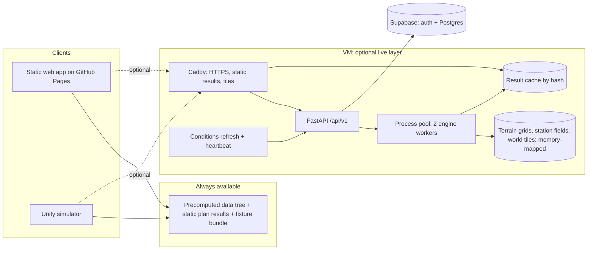

# Backend expansion — plan and specification

> Exported from Notion ("Backend expansion — plan and specification", last edited 2026-11-14 18:43 UTC)
> at the backend bootstrap (C, 2026-11-14 ~20:15 CET). Decisions D50–D57 (docs/backend-plan.md §1)
> are applied below where they change the text; changed spots are marked **[D5x]**.
> Implementation plan, schedule and task list: `docs/backend-plan.md`.

**What this is.** The plan for HOMELINE's backend: an **optional live layer** on top of the finished
static app (D40, D41, D48). It adds custom pad locations, custom routes and crews, accounts with saved
and shared plans, services for the Unity simulator, a live mission-control view, contingency
replanning and fresh conditions.

**Four principles.**

1. **Static first.** The submitted app works fully with the server switched off. The headline,
   video, scorecard and validation never depend on the backend.
2. **Same engine, same numbers.** The server imports `pipeline/engine` unchanged. A parity test
   proves that the live result for the official pad equals the precomputed files (**[D56]** synthetic
   world in CI, real data locally via `make parity` and in `deploy.sh`).
3. **No login to look.** Guests can compute, view and share plans. Login is only for a personal plan
   library. (Submission gate: links must work logged out.)
4. **Every live number is labelled and traceable.** Each result carries its inputs, engine version,
   config hash and UTC time, and the label "Computed live · not part of the validated scorecard".

## 1. Why a backend

- The spec's primary user is the intravehicular crewmember who runs the EVA from the rover
  (SPEC §1.2). A backend lets that person plan *their* EVA: parking spot, crew, stations, then watch it run.
- The "users today" are NASA EVA, suit and architecture teams. Their question is "what if the suit
  weighs 95 kg and the crew member 60 kg?". The live engine answers any case inside the model's range.
- The pad question showed the limit of precomputation (D21 picker with a handful of pads).
- The Unity simulator needs a plan source (D41 bundle format). Every saved plan becomes a simulator input.

## 2. Features

Tiers: **Live-MVP** (gate B1), **Live-Core** (B2), **Live-Stretch** (B3). Gate times: **[D50]**
`config/backend.yaml gates_local` (B0 Sun 00:00, B1 03:30, B2 07:00, B3 08:00 CET).

| ID | Feature | Tier | WS | Depends on |
| --- | --- | --- | --- | --- |
| F23 | Live engine API with static-first fallback | Live-MVP | WS11, WS13 | Engine (WS2), contracts |
| F24 | Custom pad locations: validate, instant preview, full plan | Live-MVP | WS11, WS13 | F23, station fields |
| F25 | Custom route planning: station choice and order, dwell, EVA length, start time, storm timing, up to 3 user science points | Live-Core (science points: Stretch) | WS11, WS13 | F24 |
| F26 | Custom crew and suit: body mass, suit mass, tools, VO₂max, effort cap, walkback budget, dose allowance | Live-Core | WS11, WS13 | F23 |
| F27 | Accounts and plan library: login, save, versions, duplicate, delete | Live-Core | WS12, WS13 | Supabase |
| F28 | Sharing without login: permalinks by result hash, share codes, JSON export and import, cuff card for any plan | Live-MVP (permalink, export) → Core | WS12, WS13 | F23 |
| F29 | Plan comparison: two plans side by side | Live-Stretch | WS13 | F28 |
| F30 | Simulator services (Unity): plan bundle, world tile service, version check, fixture bundle | Live-Core | WS14 | D41 contract |
| F31 | Live EVA session and mission-control view | Live-Stretch | WS14, WS13 | F30 |
| F32 | Replan from here | Live-Stretch | WS11, WS13 | F25 |
| F33 | Siting on demand (D21 score) | Live-Stretch | WS11 | F25, F26 |
| F34 | Fresh conditions: scheduled refresh of RAD dose rate, light time, weather readouts | Live-Stretch | WS12 | WS4 code |
| F35 | Live provenance: run records, parity test, "verify this plan" view, public API docs | Live-MVP | WS11, WS12 | F23 |
| F36 | Operations: deploy, HTTPS, rate limits, monitoring, admin status view | Live-MVP | WS12 | Server |

**Cut order** (first → last): team workspaces (not planned) → F29 compare → F33 siting on demand →
F34 fresh conditions → planned-vs-simulated view (F31) → mission-control view (F31) → F32 replan →
user science points (F25) → F26 custom crew → F27 accounts (keep permalinks and JSON export) → F25
route editing (keep "best route") → F24 full plan (keep the instant preview).

**Never cut once started:** the static fallback, the parity test, the "computed live" label, rate limits.

**Not building:** a public gallery or search of user plans, comments or chat, payments, roles beyond
owner, multi-site support, 3D view for custom routes unless the tile service lands early, any feature
that needs the server for the headline or video.

## 3. Feature specifications

### F23 — Live engine API with static-first fallback

- **API:** FastAPI under `/api/v1`. Heavy work runs as jobs in a process pool (2 workers); light
  lookups answer directly.
- **Result = a data tree in the existing contracts.** A job writes `results/{hash}/` with the same
  files the static app loads from `web/public/data/` plus `run_record.json`. The web loader takes a
  base URL (`dataUrl(path, mode, base)`, P0), so a live plan renders through the existing code paths.
- **Hash [D57]:** `contracts/README.md ("Backend family")` "Result hash": canonical inputs (defaults filled,
  title removed) + engine tree (`git rev-parse HEAD:pipeline`) + engine config hash (all
  `config/*.yaml` except `backend.yaml`) + terrain data hash; first 16 hex characters. The same inputs never compute twice.
- **Fallback:** the web app calls `GET /api/v1/health` at load (2 s timeout). If it fails, live
  controls are hidden behind "Live planning is offline · showing precomputed plans". Results for the
  official pad and the picker pads are also shipped as static files under their hashes.
- **Acceptance:** with the server stopped, every static view passes its tests; with it running, the parity test passes.

### F24 — Custom pad locations

**Key fact:** the per-station fields (one forward and one reverse search per station) do not depend
on the pad. They are computed once per crew scenario and reused.

| Step | What happens | Time (estimate) |
| --- | --- | --- |
| 1. Click the map | `POST /pads/validate`: on measured ground, max slope ≤ 5° over 20 × 20 m, flat 30-min disc inside the grid (D21). Invalid pads get a reason and the nearest valid block | < 1 s |
| 2. Instant preview | `POST /pads/screen`: pad ↔ station times from the station fields; reachable stations, feasible EVAs (D21 score), best route estimate | < 1 s |
| 3. Full plan | `POST /jobs` (type `plan`): return fields for the three variants, bands, isochrones, edge causes, headline, route and timeline, worst-case fields, HUD field PNGs, partner line, pad horizon, time to dark | spec: 20–40 s, staged. **To be re-measured (WS2 timing task):** the last batch run spent 564 s in `web_products` for 9 scenarios |

- **Stages:** nominal band and route first, then conservative and optimistic bands, then HUD fields,
  partner line and horizon. The map fills in as stages arrive.
- **Stays on the official pad:** Navcam skyline validation and the 3D view. Station cards keep their Navcam photo.
- **HUD:** "Play this plan" opens the 2D HUD on the live result.
- **Acceptance:** official pad via the API equals the precomputed tree; an invalid pad never produces
  a plan; a pad on an unknown cell is refused with "no 1 m terrain here".

### F25 — Custom route planning

- **Station choice:** "best" (exact DP, as F9), a fixed set (best order), or a fixed order.
- **Per plan:** dwell per station (5–120 min), EVA length (2–8 h), reserve, start time (LMST), walkback budget.
- **Storm:** none, or the 20 May 2024 storm with the tripwire at the route's largest time home (D39
  default, `route_max_t_home`) or at a chosen EVA minute.
- **User science points (stretch):** up to 3 per plan, ids `U1`–`U3`, access cell within 50 m (D27),
  two field searches each; label "user station · no science scoring".
- **Infeasible plans are answered, not refused:** the result names the first leg where the margin goes negative and the binding term.
- **Acceptance:** default inputs reproduce `route_nom_104`; DP equals brute force on 8 stations; a
  fixed order that breaks a margin is reported at the right leg.

### F26 — Custom crew and suit

Ranges and defaults: `config/backend.yaml ranges` (defaults referenced from `crew.yaml`).

| Parameter | Range | Default | Note |
| --- | --- | --- | --- |
| Body mass | 50–100 kg | 75 | D10 |
| Suit mass | 60–180 kg | 104 | 80/104/120 precomputed; ICES anchor 120 kg |
| Tools | 0–30 kg | 10 | |
| VO₂max | 30–60 mL/kg/min | 36 | NASA surface-EVA minimum |
| Effort cap | 40–70% | 50% | |
| Walkback budget | 10–90 min | 30, 60 | contour level only |
| Dose allowance | 0.25–1.0 mGy | 0.5 | D9 |

- A changed crew changes every edge cost, so station fields are recomputed (≤ 2 searches per station), cached by hash.
- Values outside the anchored range get "outside the anchored range (ICES-2026-127, IST-2)". The three variants always run.
- The partner-line casualty mass comes from config (`haul.suited_casualty_kg`: `crew.yaml` body mass + suit mass), not from the crew's body mass override (D87).
- **Acceptance:** heavier suit never increases reach; defaults reproduce the precomputed scenario; out-of-range inputs rejected with the allowed range.

### F27 — Accounts and plan library

- **Login:** Supabase Auth, GitHub login first; email link only if a custom mail sender is configured (O3).
- **Library:** title, notes, created/updated, thumbnail. Save, rename, duplicate, delete. Each save creates a version; last 20 kept.
- **A plan stores inputs (`plan_inputs.json`, D52), not results.** Results are fetched by hash and
  recomputed if the engine changed ("computed with an older engine · recompute").
- **Visibility:** private (default) or link. No public listing.
- **Account deletion** removes profile, plans, versions and sessions.

### F28 — Sharing without login

- **Permalink:** `#/plan/{hash}` opens any computed result read-only for anyone.
- **Share code [D55]:** `HL-` + 6 Crockford base32 characters (e.g. `HL-7K2Q9M`) for typing into Unity.
- **JSON export and import:** `plan_inputs.json` (D52). Import works with the server down for viewing inputs.
- **Cuff card and timeline** for any plan, fed by the live result.

### F29 — Plan comparison

Two plans side by side: reachable area at 30/60 min with range, science value, EVA time, lowest
margin and binding term, O₂ used, partner-line coverage, map with both homelines. Pure front end.

### F30 — Simulator services (Unity)

- **Bundle:** `GET /plans/{ref}/bundle` builds the D41 zip from a result tree via
  `tools/make_bundle.build_plan_bundle` (**[D53]**, no second builder). Cached by hash.
- **World:** v1 serves the existing world pack at `/world/{version}/`; tiles (1 m heights float32,
  0.5 m ortho JPEG, 8 m far grid, horizon ring) follow when custom routes leave the corridor.
  **Open (WS14/C):** the world pack is in the official pad's local frame; a custom-pad plan bundle is
  in its own pad frame. The tile index must state the projected origin so the simulator can offset.
- **Version check:** `GET /engine/version`.
- **Fixture:** `contracts/bundle/fixtures/official_pad_v1/` (committed, D41).

### F31 — Live EVA session and mission-control view

1. `POST /sessions` from a plan → session id, write key (simulator), view key (console).
2. Simulator posts telemetry once per second (`telemetry.schema.json`).
3. Server looks up the fields, recomputes O₂ with the reference physiology (`physio_core`), evaluates margin and alarms, stores the sample.
4. Console receives state over server-sent events (`telemetry.schema.json`, state event), incl. simulator vs reference O₂.
5. Console commands ("advise turn back", "replan", text) return in the response to the next telemetry post.
6. Ending the session stores a run log; the run view overlays planned vs simulated.

**Acceptance:** scripted replay of the planned route gives margins within ±0.5 min of the timeline;
alarms fire at the planned times; a dropped connection resumes the session.

### F32 — Replan from here

Input: session or plan, current position, EVA time, O₂ left, stations done. One forward search from
the current position plus the DP over the remaining stations → best remaining route or "head home
now". Result is a new plan version linked to the original.

### F33 — Siting on demand

`POST /jobs` (type `siting`): score every valid candidate block with the D21 rule using the station
fields; return the top 5 with scores and a heatmap PNG.

### F34 — Fresh conditions

A 6-hourly job re-runs the WS4 fetchers (RAD dose rate and lag, light time, REMS), writes
`conditions/latest.json` with its own manifest entries. Frozen values stay the default and the only
ones on the scorecard. Config switch `conditions_refresh.enabled` (O4: Local Lead).

### F35 — Live provenance and API documentation

- **Run record** per result (`run_record.schema.json`).
- **Verify view:** `#/plan/{hash}/provenance`.
- **Parity test [D56]:** official pad, default inputs → equal to `web/public/data/` (fields exact,
  GeoJSON to 6 decimals, manifest values equal). Real data: `make parity` before every merge touching
  `server/engine` and in `deploy.sh`; CI: `make parity-synthetic`.
- **API docs:** OpenAPI at `/api/docs` (source `openapi.yaml`), linked from `/about`.

### F36 — Operations

One VM, Docker Compose (API + Caddy for HTTPS), restart on failure, external uptime check, team
status view, kill switch (`HL_HEAVY_JOBS_OFF`) that turns heavy jobs off while cached results and the
static fallback stay.

## 4. Architecture



### 4.1 Compute model

| Item | Value | Basis |
| --- | --- | --- |
| Routing grid | 2,600 × 2,600 cells at 3 m | WS1 |
| One field search | about 7 s | WS2 log (Numba Dijkstra) |
| Memory per worker | about 0.5 GB during a search (estimate) | |
| Server | 4 vCPU, 8 GB RAM, 80 GB disk | |
| Station fields | 2 per station per scenario, float32 (27 MB each); precomputed for 3 variants at 104 kg | pad-independent |
| Cache | on disk, LRU, 20 GB cap; static-shipped hashes never evicted | |
| Server data | about 2–3 GB, `make serverdata` | |

- Processes, not threads (CPU-bound). Grids memory-mapped read-only and shared. Numba compiled at start-up, before `/health` reports warm.
- Queue: at most 20 waiting jobs; timeout 180 s; identical inputs attach to the running job.

### 4.2 Repository additions

```text
home-line/
├── server/
│   ├── app.py                 FastAPI app, health, version, OpenAPI          (WS11)
│   ├── settings.py            config/backend.yaml loader                     (WS12; bootstrap C)
│   ├── engine/                grids loader, job runner, plan builder         (WS11)
│   ├── api/compute/           pads, jobs, routes, siting, replan             (WS11)
│   ├── api/plans/             plans, versions, share codes, permalinks       (WS12)
│   ├── api/auth/              Supabase JWT check, rate limits                (WS12)
│   ├── api/sim/               bundle, world, sessions, telemetry, runs       (WS14)
│   ├── bundle/                thin adapter over tools/make_bundle (D53)      (WS14)
│   ├── db/                    SQL migrations and row-level security          (WS12)
│   ├── ops/                   Dockerfile, compose, Caddyfile, deploy script  (WS12)
│   └── tests/                 parity, API, security tests
├── config/backend.yaml
├── contracts/backend/         plan_inputs, run_record, job, telemetry (sample + state event), openapi.yaml
├── tools/make_serverdata.py   station fields + data sync for the server      (WS11)
└── web/src/live/              api client, pad tool, crew panel, route editor, library, share, compare, mission control (WS13)
```

## 5. API v1

Source of truth: `openapi.yaml`. Auth: G guest, U login, K session key, T team token.

| Method and path | Purpose | Auth |
| --- | --- | --- |
| GET `/health` | Up, engine warm, queue length | G |
| GET `/engine/version` | Engine tree and commit, config hash, contract versions, terrain hash | G |
| GET `/defaults` | Default plan inputs, ranges, stations, official and picker pads | G |
| POST `/pads/validate` | Pad validity and nearest valid block | G |
| POST `/pads/screen` | Instant preview from station fields | G |
| POST `/jobs` | Start a job: `plan`, `siting`, `replan` | G (rate-limited) |
| GET `/jobs/{id}` | Status, stage, progress, result URL | G |
| GET `/results/{hash}/…` | Result tree (immutable) | G |
| GET `/results/{hash}/provenance` | Run record | G |
| POST `/plans/import` | Validate an uploaded `plan_inputs.json` (≤ 1 MB), return its hash | G |
| GET, POST `/plans` | List my plans; save a plan | U |
| GET, PATCH, DELETE `/plans/{id}` | Read, rename, visibility, delete | U (owner) |
| GET `/plans/{id}/versions` | Version list | U (owner) |
| GET `/plans/by-code/{code}` | Resolve a share code | G |
| GET `/plans/{ref}/bundle` | Simulator bundle (ref = hash, id or code) | G for hash and code |
| GET `/world/{version}/…` | World pack and tiles | G |
| POST `/sessions` | Start a live session | G (rate-limited) |
| POST `/sessions/{id}/telemetry` | Telemetry in; state and commands out | K (write) |
| GET `/sessions/{id}/stream` | SSE for the console | K (view) |
| POST `/sessions/{id}/commands` | Command to the simulator | K (view) |
| POST `/sessions/{id}/end`, GET `/runs/{id}` | Close session; read run log | K |
| GET `/conditions/latest` | Refreshed conditions | G |
| DELETE `/me` | Delete my account and data | U |
| GET `/admin/status` | Queue, cache, errors | T |

## 6. Data model (Supabase Postgres)

| Table | Columns (main) | Notes |
| --- | --- | --- |
| `profiles` | user id, display name, created | Email stays in Supabase Auth only |
| `plans` | id, owner, title, notes, visibility, share code, current version, created, updated | RLS: owner only; link plans readable by code |
| `plan_versions` | id, plan, number, inputs (JSON), result hash, engine tree, config hash, created | Last 20 kept |
| `results` | hash, inputs (JSON), engine tree, config hash, status, size, created, last used, pinned | Cache index; no user data |
| `jobs` | id, type, result hash, status, stage, progress, started, finished, error, requester (hashed IP or user) | |
| `sessions` | id, plan hash, write key hash, view key hash, started, ended, owner (optional) | |
| `telemetry` | session, EVA time, x, y, z, speed, sim O₂, ref O₂, margin, binding, alarm | 1 Hz, ≤ 30,000 per session |
| `runs` | id, session, summary (JSON), created | |
| `conditions_snapshots` | time, payload (JSON) | Also the daily database heartbeat |

The API is the only database client (server-side key). Row-level security is still set on every table.

## 7. Contracts

All owned by C, `contracts/` (backend family) v1.0.0 (frozen at P0, D50), see its README. Result tree: the
existing web contracts plus `run_record.json`; scenario ids for custom crews are `nom`, `opt`, `con`
inside the result. Bundle: D41, built from a result tree. Telemetry sample:
`{t_eva_s, x_m, y_m, z_m, speed_ms, o2_left_L, source}` in the planner frame.

## 8. Security, privacy and limits

| Topic | Rule |
| --- | --- |
| Input validation | Pydantic models with the ranges in `config/backend.yaml`; unknown fields rejected; uploads ≤ 1 MB and schema-checked |
| Rate limits | Guests 6 heavy jobs / 10 min / IP; users 30; telemetry 2 posts/s/session; queue cap 20 |
| CORS | Allow-list in `config/backend.yaml api.cors_origins` |
| Secrets | Environment only (Supabase service key, team token); never in the repo or the client |
| Keys | Session write and view keys random, stored hashed, shown once |
| Personal data | Email only, in Supabase Auth (EU); IPs stored hashed, deleted after 7 days; no trackers |
| User text | Private or link-only, length-capped, rendered as text |
| Deletion | `DELETE /me` removes profile, plans, versions, owned sessions |
| Privacy note | One paragraph on `/about` |
| After the deadline | No code deploys after Sun 23:59; restarts only; deployed commit at `/engine/version` |

## 9. Hosting, deployment and durability

- One always-on VM (4 vCPU, 8 GB) at an EU provider, paid through February 2027 (owner: open, O1).
- HTTPS via Caddy; **[D51]** a free dynamic-DNS subdomain unless someone has a domain.
- Supabase Free pauses after ~a week idle: the 6-hourly conditions job writes a heartbeat row, or pay
  for Pro until February. If paused, login and library fail; guests, permalinks and computing keep working.
- `server/ops/deploy.sh`: build image, sync data, run the parity test against the new container,
  then switch. A failed parity test blocks the deploy.
- External uptime check on `/health` alerting two team members. Plans live in Supabase; results are reproducible.

## 10. What stays static

Headline, bands and route for the official pad; V1, V2, RAD checks, KATs, scorecard; Navcam skyline
overlays; 3D first-person view (custom routes only as stretch via tiles); storm replay series.

## 11. Workstreams and reviewers

| WS | Scope | Features | Reviewer |
| --- | --- | --- | --- |
| WS11 Engine service | API skeleton, grids loader, job runner, pads, plan builder, routes, custom crew, replan, siting, cache, parity, `make serverdata` | F23–F26, F32, F33, F35 (run records) | N (code, parity), S (science) |
| WS12 Accounts, plans, ops | Supabase schema and policies, auth, plans and versions, share codes, rate limits, deploy, HTTPS, monitoring, conditions refresh, privacy note | F27, F28, F34, F35 (docs), F36 | G |
| WS13 Live web UI | API client and fallback, pad tool, crew panel, route editor, staged results, library, share, compare, mission control, run view | F23–F29, F31 (views) | D |
| WS14 Simulator services | Bundle endpoint, world service, sessions, telemetry, commands, run logs | F30, F31 | R (Unity liaison), C (contracts) |
| WS2 support | `build_plan`, `station_fields`, `physio_core`, crew as parameter, determinism | — | S, C |
| C | backend contracts, loader base URL, bundle wrapper | — | — |

At most two agent sessions per reviewer (**[D54]** sequencing in docs/backend-plan.md §7).

## 12–15. Gates, tests, risks, open decisions

See `docs/backend-plan.md` (§4 schedule, §6 task list with acceptance checks, §8 risks) and the
Notion spec for the full original tables. Open decisions: O1 server owner and payer (team lead), O3
mail sender (by B2), O4 fresh conditions after the deadline (Local Lead, by B3), O5 Unity liaison (team lead).
